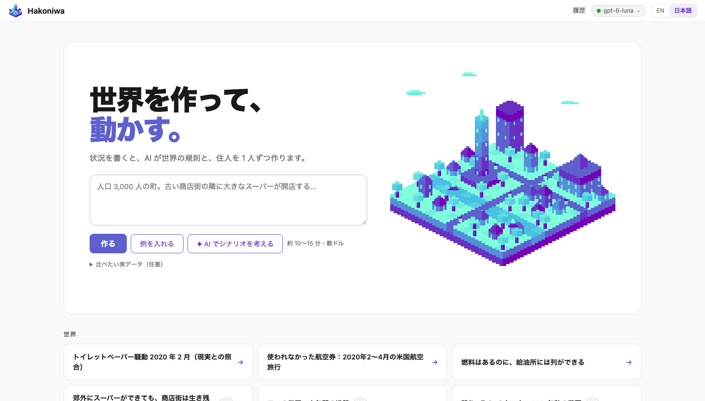
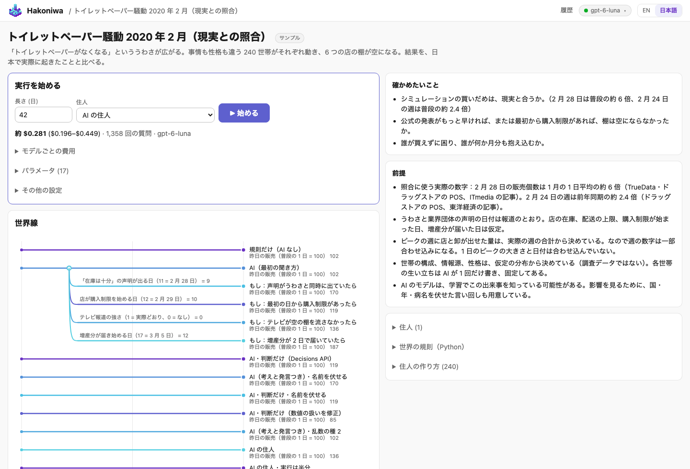
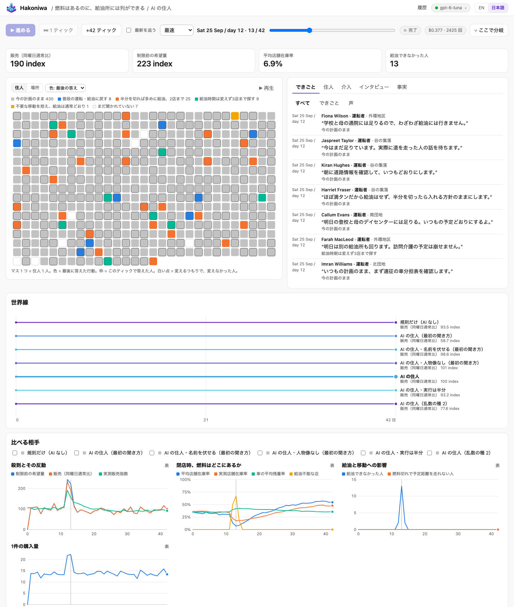
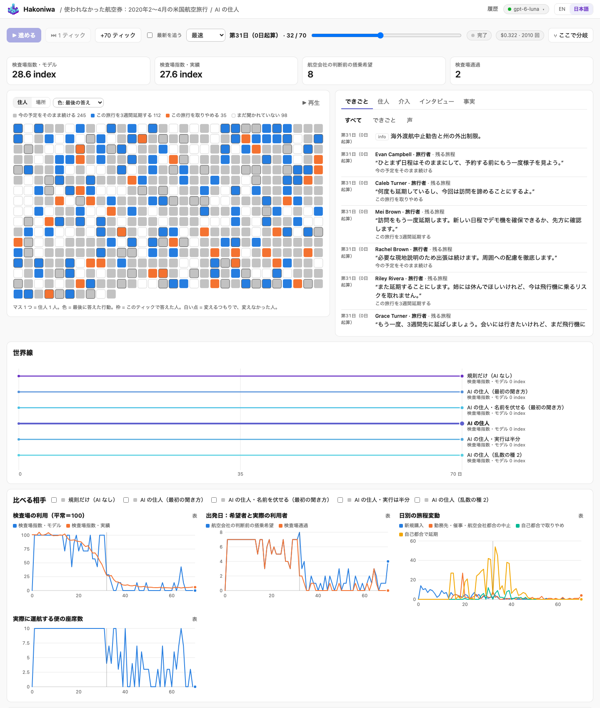
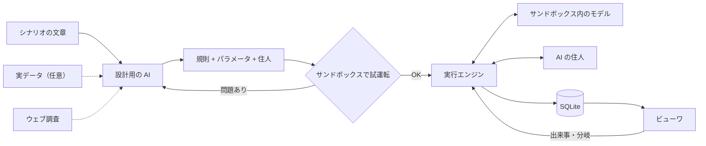

<div align="center">


<h1>Hakoniwa（箱庭）</h1>

<em>規則で動く小さな世界に、AI の住人を住まわせる。状況を書いて、動かして、手を入れて、結果を比べる。</em>

[](./CHANGELOG.md)
[](./LICENSE)
[](https://www.python.org/)
[](./docker-compose.yml)
[](#-設定)
[](#-画面)

[English](./README.md) | 日本語 | [現実との照合レポート（英語）](./docs/reports/) | [設計メモ](./docs/DESIGN.ja.md) | [Cloud Run へのデプロイ](./docs/CLOUD_RUN.ja.md)

</div>

## ⚡ 概要

**Hakoniwa** は、数行の文章から小さな世界を作り、動く様子を眺める道具です。

- **数字は規則が動かします。** 人、お金、行列、在庫は、小さな Python のモデル（オートマトン）が 1 ティックずつ進めます。
- **住人は AI が演じます。** 住人には仕事、性格、生い立ちがあります。モデルは、その人に新しい知らせが届いたときだけ「どうしますか」と聞きます。答えはせりふと一緒に規則へ戻ります。
- **あなたは観察者です。** 止める、パラメータを変える、出来事を起こす、好きな時点で分岐する。分岐した世界線は同じグラフで比べられます。
- **世界はツールが組みます。** シナリオから、設計用の AI が規則・パラメータ・住人を書き、サンドボックスで試し、壊れていれば直します。実データを貼ると、検証用として別に取っておきます。

動くのは手元だけです（SQLite のファイル 1 つとサンドボックス）。外に出るのは AI の API 呼び出しだけです。住人 500 人ほどの実行 1 回で約 $0.40、世界を 1 つ組むのに約 $3〜4 です（既定のモデルの場合）。

> 結果は予測ではありません。[現実の出来事との照合](#-どこまで現実に近づくか)で、再現できたことと、できなかったことを示しています。

## 🧭 2 つの使い方

最初のページで「何をしたい？」を選びます。

| | 社会を眺める | 自分の分かれ道を見る |
|---|---|---|
| 書くもの | 大勢の人が出てくる状況 | いまの自分の状況と、迷っていること |
| 作る前 | シナリオに曖昧な点があれば、いくつか質問 | あなたへのインタビュー（大事にしていること、怖いこと、関わる人たち） |
| 世界 | 数百人の住人 | インタビューの内容をそのまま使った「あなた」と、周りの十数人 |
| 眺め方 | 実行を 1 つずつ。途中で分岐 | すべての道の未来を、まとめていくつも。どの道にも同じ運を配る |
| 最後に | その実行のレポート | すべての未来を通したレポートと、どの未来の自分とも話せる会話 |

2 つ目のモードは、予測でも助言でもありません。占いに近いものです。こんな未来もあるかもしれない、何が分かれ目になったように見えるか、を眺めます。サンプルの人物の世界を組むのに $0.59、8 年ぶんの未来 9 本で合計 $0.11、レポートが $0.04 でした。自分について書いた内容は、設定した AI の提供元にだけ送られます。

## 📸 画面

<div align="center">
<table>
<tr>
<td></td>
<td></td>
</tr>
<tr>
<td></td>
<td></td>
</tr>
</table>
</div>

## 🧪 どこまで現実に近づくか

現実の出来事を 4 つ再現し、記録された数字と比べました。4 つのうち 3 つの世界は、約 400 語のシナリオと実データの表だけから、ツールが単独で組んだものです。実際の結果は検証用に取っておき、合わせ込みには使っていません。4 つともサンプルの世界として入っています。5 つ目のサンプル「食卓で振り返る8年間」は、分かれ道に立つ架空の 1 人の世界で、2 つ目のモードを試すためのものです。

| 出来事 | 世界を組んだのは | 合ったところ | 合わなかったところ | レポート |
|---|---|---|---|---|
| **トイレットペーパー、日本、2020 年 2 月**：240 世帯にうわさが届く | 手書き（最初の試し） | 騒ぎのピークは現実と同じ日（2/28）。約 4 週間で落ち着く。規則だけだと最後まで落ち着かない | 1 日の販売は 510（実際は約 600、通常の日 = 100）。仮定した店の在庫が上限になった | [レポート](./docs/reports/toilet-paper-japan-2020.md) |
| **給油所の行列、英国、2021 年 9 月**：運転者 480 人、給油所 6 か所 | ツール | ピークは現実と同じ日（9/24）。その後の数週間は通常より少ない。給油所の在庫は実際の曲線をなぞった（相関 0.90〜0.93） | ピークは 2 回の実行で 233 と 249（実際は 191）。騒ぎが 2 日で終わる（現実は 1 週間かけて引いた） | [レポート](./docs/reports/uk-fuel-2021.md) |
| **航空旅行の急減、米国、2020 年 2〜4 月**：旅行者 490 人 | ツール | 3 月下旬にほぼゼロになり、そのまま続く（週次の相関 0.96〜0.98、平均誤差 6〜9 ポイント） | 減り始めは、1 回は 1 日早く、もう 1 回は 8 日早い。3/16 の週が高すぎる（53〜59、実際は 34） | [レポート](./docs/reports/us-air-travel-2020.md) |
| **スポーツが止まったときのスポーツベッティング、英国、2020 年 3〜8 月**：スポーツベッター 500 人 | ツール | スポーツからスロットへの大移動は起きない（スロットの回数 103〜136、実際は 110〜118。規則だけだと 272〜374）。5〜6 月に戻る流れも記録どおり | 4 月に実競技へ賭け続けた人は 10%（実際は 45%）。AI の住人は現実ほど戻らない（76〜77、実際は 87〜90） | [レポート](./docs/reports/uk-betting-2020.md) |

途中で分かったこと：

- **最初、AI の住人は早く、大きく動きすぎました**（給油のピークは 305 で実際は 191。航空旅行は 9 日早く減った）。1 人ずつの人物像はよく効きます。人物像を外すと、欲しがる量が 1.5 倍になりました。ただし、それだけでは足りません。
- **一番効いたのは、住人への聞き方でした。** 最初の指示は「世界の規則が出す答えを真似るな」でした。これを「多くの人は、たいていの日は何も変えない。規則の答えがありそうな答えで、その人なりの理由があるときだけ外れる」に変えたのが、上の表の数字です。給油でははっきり良くなりました（ピーク 305 → 233〜249）。航空旅行での改善は、2 回の実行のばらつきと同じ程度です（週次の誤差 10.3 → 5.8 と 8.8）。今はこれが既定です。
- **規則だけでも、給油（ピーク 208）と航空旅行（週次の誤差 7.7）ではほぼ同じ近さでした。** トイレットペーパーでは、規則だけだと最後まで落ち着きません。世界は組むたびに違います。給油の世界をもう一度組ませたら、悪くなりました。
- どれも 4 つの出来事を 1〜2 回ずつ動かした結果です。参考であって、証明ではありません。人も世界も、ここにあるどの設定よりも複雑です。各レポートに、合わせた数字、検証した数字、言えないことを書いています。

国と年を住人に伏せても結果はほとんど変わらなかったので、出来事を思い出しているわけではありません。AI の住人での実行は 1 回 $0.24〜0.46、世界を組む費用は 1 つ $3〜4 でした。

**偶然の出来事**（その他の設定）：世界は「起こりうる出来事」の候補を持ちます。世界全体に起こるもの（ルールの変更、競合の動き）と、一部の人の暮らしに起こるもの（急な出費、病気）があります。既定では起こります（記録のある出来事を再現する世界だけは、既定で起こしません）。何がいつ起こるかは乱数の種で決まります。同じ種なら同じ未来、分岐しても同じ出来事に出会い、種を変えると別の未来になります。候補のない世界では、世界のページの **AI に考えてもらう** で作れます。

**点検**（世界のページ、無料）：AI なしの試運転で、選択肢を 1 つずつ全員に選ばせます。選んでも何も変わらない選択肢、一度も聞かれない人、動かない数字、単位の合わない実データを報告します。世界を作る途中でも自動で走り、欠陥は住人の生い立ちを書く前に設計モデルへ戻されます。

**その他の設定** には、住人が動きすぎるときのための補正が 2 つあります。**誰に聞くか**：その日に本当に立ち止まって考える人かを判断モデルが先に見て、残りの人はこれまで通りに動きます。**考えを変えた人のうち実行する割合**：1 より下げると、変えるつもりでも結局変えない人が出ます。どちらも既定では切ってあります。今の聞き方では不要で、割合を下げると 3 つのうち 2 つで結果が悪くなりました。

## 🔄 流れ



世界を組むとき：設計用の AI が、規則と、住人の作り方（どんな人が何割いるか）を書きます。ツールがその作り方から 1 人ずつを生成し、設計用の AI が生い立ちを書き、全体をサンドボックスで試してから保存します。

1 ティックごと：モデルが規則で 1 つ進み、判断が必要な人を挙げます。AI の住人が並行して答えます。答えは検査してからモデルに戻し、そのティックをスナップショットと一緒に保存します。だから、どの時点からでも後で分岐できます。

## 🚀 始め方

### 方法 1：Docker（おすすめ）

世界のモデルは、ネットワークなし・秘密情報なし・読み取り専用のサイドカーコンテナで動きます。

```bash
cp .env.example .env        # OPENAI_API_KEY にキーを入れる
docker compose up --build   # http://localhost:8787
```

### 方法 2：ソースから

| 道具 | バージョン | 用途 | 確認 |
|---|---|---|---|
| Python | 3.11 以上 | エンジンとビューワ | `python3 --version` |
| uv | 最新 | 依存パッケージの導入 | `uv --version` |
| Docker | 任意 | AI が書いたモデルを、世界ごとの使い捨てコンテナで動かす | `docker version` |

```bash
cp .env.example .env        # OPENAI_API_KEY にキーを入れる
uv venv --python 3.12
uv pip install fastapi uvicorn httpx
PYTHONPATH=. .venv/bin/python -m hakoniwa   # http://127.0.0.1:8787
```

API キーがなくてもサンプルの世界は動きます。そのとき住人はモデルの既定の動きに従い、外には何も送りません。

## 🖥 ビューワの使い方

1. **作る**：最初のページの上でシナリオを書き（ざっくりした案だけ書いて **AI でシナリオを考える** でも可）、**作る** を押します。シナリオに、世界の作りを左右する曖昧な点があれば、作る前に質問が出ます（選択肢から選ぶか、自分の言葉で答えるか、答えずに進めます）。世界にはすぐ専用のページができ、作っている間はそこに手順と、少しずつ組み上がっていく町が出ます（6〜18 分ほど）。ページを離れても、その間に別の世界を作り始めても構いません。トップの一覧から戻れます。現実と比べたいときは、**比べたい実データ** に実際の数字を貼ります。一覧から既存の世界を開くこともできます。
2. **始める**：長さを決め、ボタンの下の費用を確かめて、**始める** を押します。
3. **眺める**：盤面、主な数字、グラフ、出来事の流れが進みに合わせて更新されます。盤面はマス 1 つが住人 1 人で、色はその人が最後に答えた行動です。時間を進めると、考えを変えた人の色が変わっていきます。**色** のメニューで、オートマトンがその人について持っている状態（家の在庫、タンクの残量、いまの計画など）に切り替えられます。値が数種類の状態なら、盤面の下に状態遷移図が出て、いま各状態に何人いるか、どこからどこへ何人移ったかが分かります。**場所** を押すと、在庫と流れの地図に切り替わります。`Space` で一時停止と再開、`←` `→` で時間を移動、**再生** で終わった実行をもう一度流せます。
4. **手を入れる**：**介入** タブで、この実行に出来事を起こすか、分岐します。分岐は元の実行を残したまま、枝を伸ばします。1 人に介入したいときは、盤面でその人のマスを押します。言葉を伝えるか、行動を指定すると、その時点から枝が伸びます。
5. **比べる**：枝では、親の線がすべてのグラフに重なります。世界が実データを持っているときは、画面に出ている各実行が実データからどれだけ離れているかの小さな表も出ます。**比べる相手** でほかの実行も重ねられます。**世界線** には、実行がどう枝分かれし、何を変え、どこに行き着いたかが出ます。
6. **聞く・まとめる**：住人に **話を聞く**（その人の生い立ちと、これまでの考えを踏まえて答えます。話しても行動は変わりません）か、**レポートを書く** を押します。レポートは、さっと読めるように組んであります。一言での答え、何が起きたか（5 点まで）、正確な数字の表、住人の動き、実データやほかの実行との比較、言えること・言えないこと、次に試すこと 1 つ、の順です。**Markdown で保存** でファイルにできます。レポートの下の欄で、分析役に質問もできます（ピークはいつか、誰がなぜ行動を変えたか、ほかの実行とどう違うか）。
7. **発展させる**：世界のページで、その世界への思いや、次に見たいことを書きます。AI が新しい世界のシナリオに整えるので、読んで直してから作れます。
8. **履歴**（右上）：すべての実行と費用の一覧です。隣の **データ** では、選んだ世界と実行を 1 つの SQLite ファイルに書き出し、そのファイルを読み込めます。別のマシンへ移すときや、再起動でデータベースが消える環境で残したいときに使います。
9. **モデル**：右上のモデル名を押すと、世界の構築・住人・レポートに使うモデルと推論の強さを選べます。

コマンドライン：

```bash
python -m hakoniwa worlds
python -m hakoniwa estimate forecourt_evenings
python -m hakoniwa run tp_2020 --report
python -m hakoniwa run the_unused_ticket --no-ai      # 規則だけ。AI の費用なし
python -m hakoniwa check                              # すべての世界をサンドボックスで検査
python -m hakoniwa export <slug> <dir>                # 作った世界をファイルに書き出す
```

## ⚙ 設定

設定は `.env` に書きます。

| 変数 | 既定 | 意味 |
|---|---|---|
| `OPENAI_API_KEY`、`OPENAI_BASE_URL` | なし、`https://api.openai.com/v1` | Chat Completions API と同じ形の提供元ならどこでも |
| `HAKONIWA_MODEL_DESIGNER`、`HAKONIWA_EFFORT_DESIGNER` | `gpt-6.2-astra`、`medium` | 世界を組む（規則と住人） |
| `HAKONIWA_MODEL_DRAFT`、`HAKONIWA_EFFORT_DRAFT` | `gpt-6.2-sol`、`low` | ざっくりした案をシナリオにする |
| `HAKONIWA_MODEL_AGENT`、`HAKONIWA_EFFORT_AGENT` | `gpt-6-luna`、`low` | 実行中の住人（小さな呼び出しが多数） |
| `HAKONIWA_MODEL_REPORT`、`HAKONIWA_EFFORT_REPORT` | `gpt-6.2-sol`、`low` | レポート |
| `HAKONIWA_RESEARCH` | `none` | `responses` にすると、設計時に OpenAI Responses API でウェブ検索する |
| `HAKONIWA_SANDBOX` | `auto` | `docker`、`remote`（compose のサイドカー）、`process`（隔離なし） |
| `HAKONIWA_LLM` | `auto` | `mock` にすると AI を使わない |
| `HAKONIWA_LANGS` | `en,ja` | 住人が話す言語 |
| `HAKONIWA_DB` | `data/hakoniwa.db` | SQLite のファイル |
| `HAKONIWA_BACKUP_DIR`、`HAKONIWA_BACKUP_MINUTES` | なし、`5` | マシンが消えても残るフォルダ（マウントしたバケットなど）。データベース丸ごとの圧縮した控えをそこに置き、データベースが無いときはそこから戻します。[Cloud Run へのデプロイ](./docs/CLOUD_RUN.ja.md)を参照 |
| `HAKONIWA_MAX_IMPORT_MB` | `512` | **データ** で読み込めるファイルの上限 |

ビューワで選んだモデルと推論の強さは保存され、`.env` より優先されます（「.env の設定に戻す」で解除）。
役割ごとに別の提供元も使えます：`HAKONIWA_AGENT_BASE_URL`、`HAKONIWA_AGENT_API_KEY`（`DESIGNER`、`DRAFT`、`REPORT` も同様）。
費用の見積もりに使う単価は `prices.json` にあります。載っていないモデルは 1 行足してください。

## 🧱 構成

```
hakoniwa/
  domain/          純粋な規則：世界の契約、判断、住人の生成、料金     （入出力なし）
  application/     ユースケース：実行エンジン、世界の設計、見積もり、観察者。ports.py
  infrastructure/  アダプタ：SQLite、サンドボックス、OpenAI 互換クライアント、設定
  interface/       HTTP API、CLI、ビューワ
  worlds/          サンプルの世界：spec.json + model.py（+ data.json、cast.json）
  bootstrap.py     アダプタをポートにつなぐ
sandbox/           世界のモデルを 1 つ動かすランナー。イメージとサイドカー
tools/             make_icon.py：10 色のブロックからドット絵の町（アイコン、動く絵、組み立て用の部品）を作る
```

依存は内向きです。`interface` と `infrastructure` は `application` に、`application` は `domain` に依存します。
サーバーは 1 プロセスで API とビューワを出します。実行は裏のタスクとして進み、ブラウザを閉じても止まりません。

### 世界の契約

世界は `spec.json`（パラメータ、住人、指標、グラフ、出来事）と `model.py` です。データ（住人 1 人ずつの一覧、比べたい実際の数字）も持てて、モデルは `params["_data"]` で受け取ります。

```python
init(params, rng) -> state                      # JSON にできる dict
step(state, params, rng, t) -> events           # 規則で 1 ティック進める
decisions(state, params, t) -> requests         # いま判断が必要な人（聞きすぎない）
apply(state, params, rng, t, action) -> events  # 答えを状態に戻す
metrics(state, params, t) -> {id: number}
view(state, params, t) -> {clock, nodes, links} # ビューワの地図
invariants(state, params, t) -> [problems]      # 保存則の検査
on_params(state, params, patch, t) -> events    # 観察者が途中でパラメータを変えた
```

どの質問にも `default`（AI なしのときの動き）が付きます。モデルは既定の動きだけでも筋の通った動きをしなければなりません。この無料の試運転が、実行前の費用見積もりにも使われます。

## 🔒 安全

- ビューワにログインはありません。127.0.0.1 で待ち受けます。本人確認のプロキシを手前に置かずに、外へ公開しないでください（[Cloud Run へのデプロイ](./docs/CLOUD_RUN.ja.md)に一例があります）。
- **データ** から読み込んだ世界は、AI が書いたものとして扱います。そのコードは、隔離されたサンドボックスでしか動きません。
- AI が書いたモデルのコードは、ネットワークなし・秘密情報なし・読み取り専用・CPU とメモリに上限のあるサンドボックスの中だけで動きます。`process` は隔離がないため、`HAKONIWA_ALLOW_UNSAFE_SANDBOX=1` を付けない限り、AI が書いた世界を動かしません。
- 実行は、予算に達すると AI に聞くのをやめます（**その他の設定** の「この金額で止める」）。

## 🧪 テスト

```bash
uv pip install pytest pytest-asyncio
HAKONIWA_LLM=mock PYTHONPATH=. .venv/bin/python -m pytest -q
```

## 📄 謝辞

Hakoniwa は [MiroFish](https://github.com/666ghj/MiroFish)（SNS 上の AI エージェントの群れをシミュレートする）に刺激を受けて作りました。進め方は違います。世界の状態は規則が動かす数字で、AI を呼ぶのは誰かが判断するときだけです。

## 📜 ライセンス

[MIT](./LICENSE)
