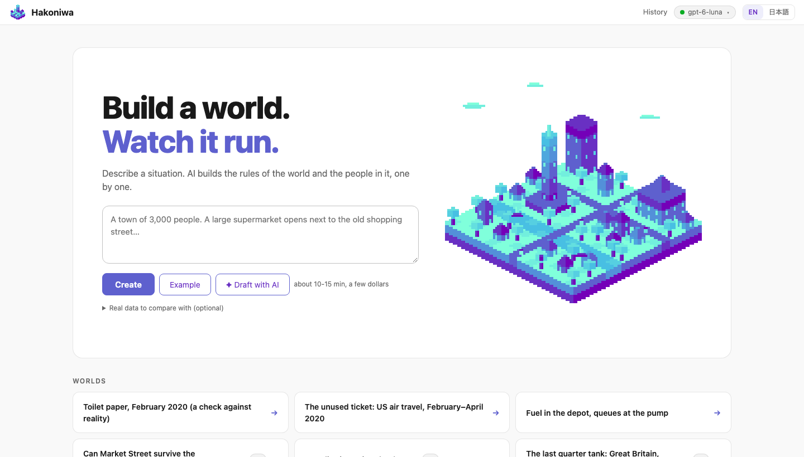
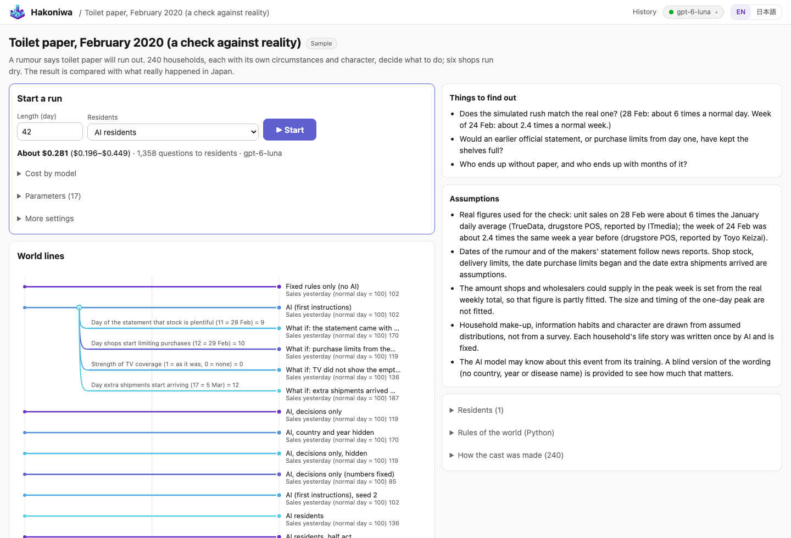
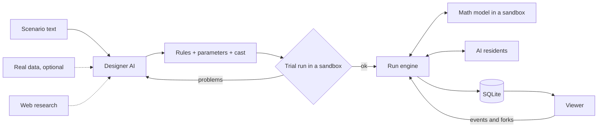

<div align="center">



<h1>Hakoniwa</h1>

<em>Small worlds that run on rules, with AI residents. Describe a situation, watch it run, step in, and compare what happens.</em>

[](./CHANGELOG.md)
[](./LICENSE)
[](https://www.python.org/)
[](./docker-compose.yml)
[](#-configuration)
[](#-screenshots)

English | [日本語](./README.ja.md) | [Checks against reality](./docs/reports/) | [Design notes](./docs/DESIGN.md) | [Deploy to Cloud Run](./docs/CLOUD_RUN.md)

</div>

## ⚡ Overview

**Hakoniwa** (箱庭, "box garden") builds a small simulated world from a few sentences and lets you watch it.

- **Rules move the numbers.** People, money, queues and stock live in a small Python model (an automaton) that advances one tick at a time.
- **AI plays the residents.** Each resident has a job, a character and a life sketch. The model asks them what they do only when something new reaches them. The answer goes back into the rules, with a line of speech.
- **You are the observer.** Pause, change a parameter, trigger an event, fork the run at any tick, and compare the branches (world lines) on the same charts.
- **The tool builds the world.** From your scenario, a designer AI writes the rules, the parameters and the cast, tests them in a sandbox, and repairs them when they break. Paste real data and it is kept aside as a test.

Everything is local (one SQLite file and a sandbox) plus one AI API. A run with about 500 residents costs about $0.40; building a world costs $3–4 with the default models.

> Results are not forecasts. Three [checks against real events](#-how-close-does-it-get) show what the tool reproduced and what it did not.

## 🧭 Two ways to use it

The top page asks what you would like to do.

| | Watch a society | Look down my own crossroads |
|---|---|---|
| You write | A situation with many people in it | Where you stand and what you are weighing |
| Before building | A few questions if the scenario leaves something open | An interview about you: what matters, what you fear, the people involved |
| The world | A few hundred residents | You, taken from the interview word for word, and the dozen or so people around you |
| You watch | One run at a time, with forks | Several futures of every path at once, each path with the same strokes of luck |
| At the end | A report on the run | A report across all the futures, and a talk with any of those future selves |

The second mode is not a forecast and not advice. It is closer to reading the cards: here is what could happen, and here is what seemed to make the difference. Building the sample person's world cost $0.59; nine futures of eight years cost $0.11 in all, and the report $0.04. What you write about yourself is sent to the AI provider you configured, and to nothing else.

## 📸 Screenshots

<div align="center">
<table>
<tr>
<td></td>
<td></td>
</tr>
<tr>
<td></td>
<td></td>
</tr>
</table>
</div>

## 🧪 How close does it get

Four real events were replayed and compared with recorded figures. Three of the four worlds were built by the tool alone from a scenario of about 400 words and a table of real data; the real results were held back as a test and nothing was fitted to them. All four ship as sample worlds. A fifth sample, *Eight years at the kitchen table*, is a world about one made-up person at a crossroads, for trying the second mode.

| Event | World built by | What matched | What did not | Report |
|---|---|---|---|---|
| **Toilet paper, Japan, Feb 2020**: 240 households hear a rumour | by hand (first trial) | The rush peaked on the real day (28 Feb) and died down in about four weeks; with fixed rules alone it never did | One-day sales 510 against a real 600 (normal = 100), capped by the assumed shop stock | [report](./docs/reports/toilet-paper-japan-2020.md) |
| **Fuel rush, Great Britain, Sep 2021**: 480 drivers, six stations | the tool | Peak on the real day (24 Sep). Sales below normal for weeks afterwards. Station stock followed the real curve (correlation 0.90–0.93) | Peak 233 and 249 in two runs against a real 191, and over in two days where the real rush faded over a week | [report](./docs/reports/uk-fuel-2021.md) |
| **Air travel, United States, Feb–Apr 2020**: 490 travellers | the tool | Travel fell to almost nothing by late March and stayed there (weekly correlation 0.96–0.98, mean error 6–9 points) | The slide began one day early in one run and eight days early in another. The week of 16 March was too high (53–59 against 34) | [report](./docs/reports/us-air-travel-2020.md) |
| **Sports betting when sport stopped, Great Britain, Mar–Aug 2020**: 500 sports bettors | the tool | No rush from sports to slots (slot spins 103–136 against a real 110–118; fixed rules gave 272–374). Betting returned in May and June as recorded | In April only 10% still bet on real events, against a real 45%. AI residents came back less than real bettors did (76–77 against 87–90) | [report](./docs/reports/uk-betting-2020.md) |

What was learned on the way:

- **AI residents first reacted too soon and too hard** (fuel peak 305 against 191; air travel fell nine days early). Each person's own description helps a lot: without it they wanted half as much again. It is not enough.
- **How residents are asked mattered most.** The first instructions told them not to copy the world's own formula. Telling them instead that most people change nothing on most days, and that the formula is the likely answer unless this person has a reason to differ, gave the figures in the table. On the fuel check the gain is clear (peak 305 → 233–249). On air travel it is no larger than the spread between two runs (weekly error 10.3 → 5.8 and 8.8). That wording is now the default.
- **Fixed rules alone were about as close** on fuel (peak 208) and air travel (weekly error 7.7). On toilet paper they never calmed down. Worlds also differ from build to build: another build of the fuel world was worse.
- These are one or two runs of four events, a reference and not a proof. People and worlds are more complicated than any of these settings. Each report lists what was fitted, what was tested and what cannot be said.

Hiding the country and the year from the residents changed little, so they were not simply recalling the event. One AI run cost $0.24–0.46. Building a world cost $3–4.

<details>
<summary>Example: from a rough idea to a scenario</summary>

The **Draft with AI** button turns a rough idea into a scenario you can build from.

Idea: *"A ramen shop queue. I want to see what happens if they raise the price."*

Draft (translated from the Japanese output): *"One ramen shop in front of a station, with 12 counter seats, 3 staff, and room for 15 people to queue outside. Five weekday lunchtimes, 11:00 to 14:00, one minute per step. Office workers and students on their lunch break look at the price and the queue, then decide to join or go elsewhere, and leave the queue when time runs short. Staff seat customers, cook in order, and decide whether to change who does what. Each step records arrivals, queue length, waiting time, free seats, bowls served and sales. Compare keeping the price at 850 yen with raising it to 950 yen mid-week, and with announcing the rise a day ahead. Does the queue get shorter, do fewer people give up, and do lunchtime sales go up?"*

</details>

## 🔄 Workflow



Building: the designer writes the rules and a recipe for the cast (who lives there, in what proportions). The tool draws the individuals from the recipe, the designer writes a life sketch for each kind of person, and the whole world is tried in a sandbox before it is saved.

Each tick: the model advances by its rules, then lists who needs to decide. AI residents answer in parallel. The answers are checked and put back into the model, and the tick is stored with a snapshot, so any tick can be forked later.

## 🚀 Quick Start

### Option 1: Docker (recommended)

World models run in a sidecar container with no network access, no secrets and a read-only filesystem.

```bash
cp .env.example .env        # put your key in OPENAI_API_KEY
docker compose up --build   # http://localhost:8787
```

### Option 2: From source

#### Prerequisites

| Tool | Version | Description | Check |
|---|---|---|---|
| Python | 3.11+ | Engine and viewer | `python3 --version` |
| uv | Latest | Installs the dependencies | `uv --version` |
| Docker | Optional | A throwaway container per world for AI-written models | `docker version` |

#### 1. Configure

```bash
cp .env.example .env        # put your key in OPENAI_API_KEY
```

#### 2. Install

```bash
uv venv --python 3.12
uv pip install fastapi uvicorn httpx
```

#### 3. Start

```bash
PYTHONPATH=. .venv/bin/python -m hakoniwa   # http://127.0.0.1:8787
```

With no API key the sample worlds still run. Residents then follow each model's default behaviour, and nothing is sent anywhere.

## 🖥 Using the viewer

1. **Create**: write a scenario at the top of the first page (or press **Draft with AI** with a rough idea) and press **Create**. If the scenario leaves something open that would change the world, you are asked first: pick an option or answer in your own words, or skip. The world gets its own page at once: while it is being built that page shows the steps and a town going up piece by piece (about 6 to 18 minutes). You can leave it, start another world meanwhile, and come back from the list on the top page. To check against reality, paste the real figures under **Real data to compare with**. Or open a world from the list.
2. **Start**: set the length, check the cost under the button, press **Start**.
3. **Watch**: the board, the headline numbers, the charts and the feed update as the run goes. On the board one square is one resident and its colour is their last answer, so a change of mind spreads across it as time moves. The **Colour** menu switches the board to the automaton's own state for each person (paper at home, fuel in the tank, the plan in force); for a state with a few values a diagram under the board shows how many people are in each and how many have moved between them; **Places** switches to the map of stocks and flows. `Space` pauses and resumes, `←` `→` move through time, and **Replay** plays a finished run again.
4. **Step in**: the **Intervene** tab applies an event to this run, or forks it. A fork keeps the original and starts a branch. To step in on one person, click their square on the board: say something to them or decide for them, and a branch runs on from that tick.
5. **Compare**: on a branch, the parent is drawn on every chart. Where the world carries recorded figures, a small table shows how far each run on screen is from them. Tick other runs under **Compare with**. **World lines** shows how the runs of a world branched, what changed at each fork, and where each one ended.
6. **Ask and sum up**: interview a resident (they answer from their own life story and what went through their mind; talking does not change what they do), or press **Write report**. The report is laid out for a quick read: the answer in one line, what happened in at most five points, tables of the exact figures, how the residents behaved, the comparison with recorded figures and with the other runs of the world, what it can and cannot say, and one thing to try next. **Save as Markdown** keeps it as a file. Under the report you can ask the analyst about the run: the peak, who changed course and why, how it compares with another run.
7. **Take it further**: on a world's page, write what you think of the world and what you want to see next. AI shapes it into the scenario for a new world, which you can change before creating it.
8. **History** (top right) lists every run with its cost. **Data** next to it saves chosen worlds and runs as one SQLite file and brings such a file in: for moving to another machine, or keeping things where the database does not survive a restart.
9. **Models**: click the model name (top right) to choose the model and effort for world design, residents and reports.

**Chance events** (More settings): a world carries a deck of things that may simply happen, to the world or in some people's own lives (a rule change, a rival's offer, an unexpected bill). They are on by default, except in a world that replays a recorded event. The seed decides which happen and when: the same seed gives the same future, every fork meets the same events, another seed gives another future. For a world without a deck, **Have AI write them** on its page.

**Checkup** (on a world's page, free): rehearsals with no AI in which every answer is tried on everyone in turn. It reports answers that change nothing, people who are never asked, figures that never move, and recorded figures in another unit. It also runs while a world is being built, and defects go back to the designer before the people's life sketches are paid for.

Under **More settings** two corrections for residents who react too readily can be switched on. **Who is asked**: a decision model first judges whether each person would really stop to think that day; the others carry on as before. **Share who act on a change of mind**: below 1, some residents mean to change and do not. Both are off by default. With the current instructions they were not needed: lowering the share made two of the three checks worse. They are there for worlds whose residents still overreact.

Command line:

```bash
python -m hakoniwa worlds
python -m hakoniwa estimate forecourt_evenings
python -m hakoniwa run tp_2020 --report
python -m hakoniwa run the_unused_ticket --no-ai      # fixed rules only, no AI cost
python -m hakoniwa check                              # validate every world in the sandbox
python -m hakoniwa export <slug> <dir>                # save a world you built as files
```

## ⚙ Configuration

Settings live in `.env`.

| Variable | Default | Meaning |
|---|---|---|
| `OPENAI_API_KEY`, `OPENAI_BASE_URL` | none, `https://api.openai.com/v1` | Any provider with the Chat Completions API shape |
| `HAKONIWA_MODEL_DESIGNER`, `HAKONIWA_EFFORT_DESIGNER` | `gpt-6.2-astra`, `medium` | Builds a world: its rules and its cast |
| `HAKONIWA_MODEL_DRAFT`, `HAKONIWA_EFFORT_DRAFT` | `gpt-6.2-sol`, `low` | Turns a rough idea into a scenario |
| `HAKONIWA_MODEL_AGENT`, `HAKONIWA_EFFORT_AGENT` | `gpt-6-luna`, `low` | Residents during a run (many small calls) |
| `HAKONIWA_MODEL_REPORT`, `HAKONIWA_EFFORT_REPORT` | `gpt-6.2-sol`, `low` | Written report |
| `HAKONIWA_RESEARCH` | `none` | `responses` = web search through the OpenAI Responses API while designing |
| `HAKONIWA_SANDBOX` | `auto` | `docker`, `remote` (compose sidecar) or `process` (not isolated) |
| `HAKONIWA_LLM` | `auto` | `mock` forces "no AI" |
| `HAKONIWA_LANGS` | `en,ja` | Languages residents speak in |
| `HAKONIWA_DB` | `data/hakoniwa.db` | The SQLite file |
| `HAKONIWA_BACKUP_DIR`, `HAKONIWA_BACKUP_MINUTES` | none, `5` | A folder that outlives the machine (a mounted bucket): a whole compressed copy of the database is kept there and restored when the database is missing. See [Deploy to Cloud Run](./docs/CLOUD_RUN.md) |
| `HAKONIWA_MAX_IMPORT_MB` | `512` | Largest file **Data** will bring in |

Models and effort chosen in the viewer are saved and take precedence over `.env` ("Back to .env" undoes this).
A role can use another provider: `HAKONIWA_AGENT_BASE_URL`, `HAKONIWA_AGENT_API_KEY` (same for `DESIGNER`, `DRAFT` and `REPORT`).
Prices for the cost estimate are in `prices.json`. Add a line when a model is missing.

## 🧱 Architecture

```
hakoniwa/
  domain/          pure rules: world contract, decisions, cast, pricing     (no I/O)
  application/     use cases: run engine, world designer, estimator, observer; ports.py
  infrastructure/  adapters: SQLite store, sandboxes, OpenAI-compatible client, settings
  interface/       HTTP API, CLI, web viewer
  worlds/          sample worlds: spec.json + model.py (+ data.json, cast.json)
  bootstrap.py     wires adapters to ports
sandbox/           the runner that executes one world model; image and sidecar server
tools/             make_icon.py builds the pixel-art town (icon, animated scene, build pieces) from blocks, in the ten brand colours
```

Dependencies point inward: `interface` and `infrastructure` depend on `application`, which depends on `domain`.
One server process serves the API and the viewer. Runs advance as background tasks and keep going when the browser is closed.

### The world contract

A world is `spec.json` (parameters, residents, metrics, charts, events) plus `model.py`. It may also carry data (a cast of individuals, real figures to compare with), which the model receives as `params["_data"]`:

```python
init(params, rng) -> state                      # plain JSON-able dict
step(state, params, rng, t) -> events           # one tick of math
decisions(state, params, t) -> requests         # who needs to decide now (ask sparingly)
apply(state, params, rng, t, action) -> events  # put the answer back into the state
metrics(state, params, t) -> {id: number}
view(state, params, t) -> {clock, nodes, links} # the map in the viewer
invariants(state, params, t) -> [problems]      # conservation checks
on_params(state, params, patch, t) -> events    # the observer changed parameters mid-run
```

Every request carries a `default`: what happens with no AI. A model must run sensibly on defaults alone. That free rehearsal is also how the cost of a run is estimated before it starts.

## 🔒 Safety

- The viewer has no login. It binds to 127.0.0.1. Do not expose it without an identity-aware proxy in front ([Deploy to Cloud Run](./docs/CLOUD_RUN.md) shows one way).
- A world brought in through **Data** is treated as written by AI: its code runs only in an isolated sandbox.
- AI-written model code runs only in a sandbox with no network, no secrets, a read-only filesystem and CPU and memory limits. The `process` backend is not isolated and refuses AI-written worlds unless `HAKONIWA_ALLOW_UNSAFE_SANDBOX=1`.
- A run stops asking the AI when it reaches its budget ("Stop at (USD)" under **More settings**).

## 🧪 Tests

```bash
uv pip install pytest pytest-asyncio
HAKONIWA_LLM=mock PYTHONPATH=. .venv/bin/python -m pytest -q
```

## 📄 Acknowledgments

Hakoniwa was prompted by [MiroFish](https://github.com/666ghj/MiroFish), which simulates crowds of AI agents on social platforms. Hakoniwa takes a different route: the world's state is numbers moved by equations, and AI is called only where someone has to decide.

## 📜 License

[MIT](./LICENSE)
