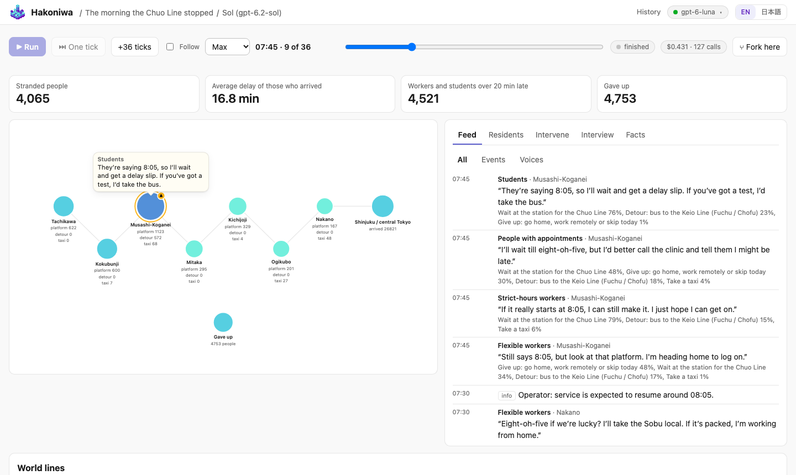
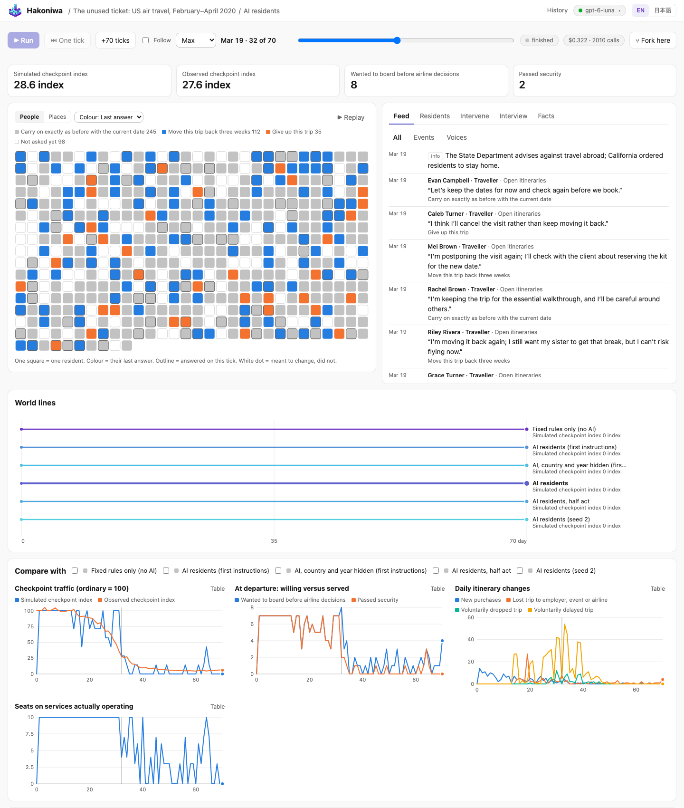
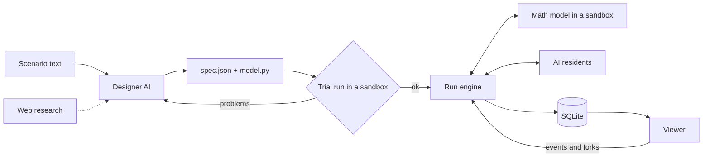

<div align="center">


<h1>Hakoniwa</h1>

<em>Small worlds that run on math, with AI residents. Describe a situation, watch it run, step in, and compare what happens.</em>

[](./LICENSE)
[](https://www.python.org/)
[](./docker-compose.yml)
[](#-configuration)
[](#-screenshots)

[English](./README.md) | [日本語](./Readme.jp.md) | [設計メモ（日本語）](./docs/DESIGN.ja.md)

</div>

## ⚡ Overview

**Hakoniwa** (箱庭, "box garden") builds a small simulated world from a few sentences and lets you watch it.

- **Math moves the numbers.** People, money, queues and capacities live in a small Python model that advances one tick at a time.
- **AI plays the residents.** At chosen moments the model asks a person or a group what they do. The answer goes back into the equations, with a line of speech.
- **You are the observer.** Pause, change a parameter, trigger an event, fork the run at any tick, and compare the branches on the same charts.
- **Worlds come from a scenario.** A designer AI writes the parameters, the residents and the model, tests them in a sandbox, and repairs them when they break.

Everything is local (one SQLite file and a sandbox) plus one AI API. A typical run costs a few cents.

> Results are not forecasts. Unless a parameter names its source, the numbers in the sample worlds are assumptions.

## 📸 Screenshots

<div align="center">
<table>
<tr>
<td></td>
<td></td>
</tr>
<tr>
<td></td>
<td></td>
</tr>
</table>
</div>

## 🧪 Examples

Three sample worlds ship with the tool. The figures are from single runs with `gpt-6-luna` playing the residents.

| World | One tick | Try this | AI calls | Cost |
|---|---|---|---|---|
| **The morning the Chuo Line stopped**: commuters at seven stations choose to wait, detour, take a taxi or give up | 5 minutes | Announce an accurate restart time early; add detour capacity | 127 | $0.03 |
| **Izu Oshima: an island and its ferries**: visitors, inns, shops, fishers, young islanders and the ferry operator | 1 week | Double the jet ferries. Does the route still pay? Does the island grow? | 80 | $0.01 |
| **Presales department**: deals, engineers, sales reps and customers under four team structures | 1 working day | Reorganise; double GPU demand; lose the best senior | 150 | $0.03 |

A world designed by AI from six lines of text (a shopping street facing a new supermarket) came out as a 463-line model with 25 parameters and 7 kinds of residents. It passed the sandbox trial on the first attempt, in about 6 minutes, for $0.32.

<details>
<summary>Example: from a rough idea to a scenario</summary>

The **Draft with AI** button turns a rough idea into a scenario you can build from.

Idea: *"A ramen shop queue. I want to see what happens if they raise the price."*

Draft (translated from the Japanese output): *"One ramen shop in front of a station, with 12 counter seats, 3 staff, and room for 15 people to queue outside. Five weekday lunchtimes, 11:00 to 14:00, one minute per step. Office workers and students on their lunch break look at the price and the queue, then decide to join or go elsewhere, and leave the queue when time runs short. Staff seat customers, cook in order, and decide whether to change who does what. Each step records arrivals, queue length, waiting time, free seats, bowls served and sales. Compare keeping the price at 850 yen with raising it to 950 yen mid-week, and with announcing the rise a day ahead. Does the queue get shorter, do fewer people give up, and do lunchtime sales go up?"*

</details>

## 🔄 Workflow



Each tick: the model advances by its equations, then lists who needs to decide. AI residents answer in parallel. The answers are checked and put back into the model, and the tick is stored with a snapshot, so any tick can be forked later.

## 🚀 Quick Start

### Option 1: Docker (recommended)

World models run in a sidecar container with no network access, no secrets and a read-only filesystem.

```bash
cp .env.example .env        # put your key in OPENAI_API_KEY
docker compose up --build   # http://localhost:8787
```

For a shared demo on Google Cloud, see the [Cloud Run deployment guide with IAP (日本語)](./docs/CLOUD_RUN.ja.md).

### Option 2: From source

#### Prerequisites

| Tool | Version | Description | Check |
|---|---|---|---|
| Python | 3.11+ | Engine and viewer | `python3 --version` |
| uv | Latest | Installs the dependencies | `uv --version` |
| Docker | Optional | A throwaway container per world for AI-written models | `docker version` |

#### 1. Configure

```bash
cp .env.example .env        # put your key in OPENAI_API_KEY
```

#### 2. Install

```bash
uv venv --python 3.12
uv pip install fastapi uvicorn httpx
```

#### 3. Start

```bash
PYTHONPATH=. .venv/bin/python -m hakoniwa   # http://127.0.0.1:8787
```

With no API key the sample worlds still run. Residents then follow each model's default behaviour, and nothing is sent anywhere.

## 🖥 Using the viewer

1. **Create**: write a scenario at the top of the first page (or press **Draft with AI** with a rough idea) and press **Create**. Or open a world from the list.
2. **Start**: set the length, check the cost under the button, press **Start**.
3. **Watch**: the map, the headline numbers, the charts and the feed update as the run goes. `Space` pauses and resumes. `←` `→` move through time.
4. **Step in**: the **Intervene** tab applies an event to this run, or forks it. A fork keeps the original and starts a branch.
5. **Compare**: on a branch, the parent is drawn on every chart. Tick other runs under **Compare with**. **World lines** shows how the runs of a world branched, what changed at each fork, and where each one ended.
6. **Ask and sum up**: interview a resident, or press **Write report**.
7. **History** (top right) lists every run with its cost.
8. **Models**: click the model name (top right) to choose the model and effort for world design, residents and reports.

Command line:

```bash
python -m hakoniwa worlds
python -m hakoniwa estimate izu_oshima --ticks 104
python -m hakoniwa run chuo_line --report
python -m hakoniwa run presales --params '{"org_model": "product_squads"}' --no-ai
python -m hakoniwa check        # validate every world in the sandbox
```

## ⚙ Configuration

Settings live in `.env`.

| Variable | Default | Meaning |
|---|---|---|
| `OPENAI_API_KEY`, `OPENAI_BASE_URL` | none, `https://api.openai.com/v1` | Any provider with the Chat Completions API shape |
| `HAKONIWA_MODEL_DESIGNER`, `HAKONIWA_EFFORT_DESIGNER` | `gpt-6.2-sol`, `medium` | Turns a scenario into a world |
| `HAKONIWA_MODEL_AGENT`, `HAKONIWA_EFFORT_AGENT` | `gpt-6-luna`, `low` | Residents during a run (many small calls) |
| `HAKONIWA_MODEL_REPORT`, `HAKONIWA_EFFORT_REPORT` | `gpt-6.2-sol`, `low` | Written report |
| `HAKONIWA_RESEARCH` | `none` | `responses` = web search through the OpenAI Responses API while designing |
| `HAKONIWA_SANDBOX` | `auto` | `docker`, `remote` (compose sidecar) or `process` (not isolated) |
| `HAKONIWA_LLM` | `auto` | `mock` forces "no AI" |
| `HAKONIWA_LANGS` | `en,ja` | Languages residents speak in |

Models and effort chosen in the viewer are saved and take precedence over `.env` ("Back to .env" undoes this).
A role can use another provider: `HAKONIWA_AGENT_BASE_URL`, `HAKONIWA_AGENT_API_KEY` (same for `DESIGNER` and `REPORT`).
Prices for the cost estimate are in `prices.json`. Add a line when a model is missing.

## 🧱 Architecture

```
hakoniwa/
  domain/          pure rules: world contract, decisions, pricing     (no I/O)
  application/     use cases: run engine, world designer, estimator, observer; ports.py
  infrastructure/  adapters: SQLite store, sandboxes, OpenAI-compatible client, settings
  interface/       HTTP API, CLI, web viewer
  worlds/          sample worlds: spec.json + model.py
  bootstrap.py     wires adapters to ports
sandbox/           the runner that executes one world model; image and sidecar server
tools/             make_icon.py builds the pixel-art town (icon and animated scene) from blocks, in the ten brand colours
```

Dependencies point inward: `interface` and `infrastructure` depend on `application`, which depends on `domain`.
One server process serves the API and the viewer. Runs advance as background tasks and keep going when the browser is closed.

### The world contract

A world is `spec.json` (parameters, residents, metrics, charts, events) plus `model.py`:

```python
init(params, rng) -> state                      # plain JSON-able dict
step(state, params, rng, t) -> events           # one tick of math
decisions(state, params, t) -> requests         # who needs to decide now (ask sparingly)
apply(state, params, rng, t, action) -> events  # put the answer back into the state
metrics(state, params, t) -> {id: number}
view(state, params, t) -> {clock, nodes, links} # the map in the viewer
invariants(state, params, t) -> [problems]      # conservation checks
on_params(state, params, patch, t) -> events    # the observer changed parameters mid-run
```

Every request carries a `default`: what happens with no AI. A model must run sensibly on defaults alone. That free rehearsal is also how the cost of a run is estimated before it starts.

## 🔒 Safety

- The viewer has no login. It binds to 127.0.0.1. Do not expose it.
- AI-written model code runs only in a sandbox with no network, no secrets, a read-only filesystem and CPU and memory limits. The `process` backend is not isolated and refuses AI-written worlds unless `HAKONIWA_ALLOW_UNSAFE_SANDBOX=1`.
- A run stops asking the AI when it reaches its budget ("Stop at (USD)" under **More settings**).

## 🧪 Tests

```bash
uv pip install pytest pytest-asyncio
HAKONIWA_LLM=mock PYTHONPATH=. .venv/bin/python -m pytest -q
```

## 📄 Acknowledgments

Hakoniwa was prompted by [MiroFish](https://github.com/666ghj/MiroFish), which simulates crowds of AI agents on social platforms. Hakoniwa takes a different route: the world's state is numbers moved by equations, and AI is called only where someone has to decide.

## 📜 License

[MIT](./LICENSE)
