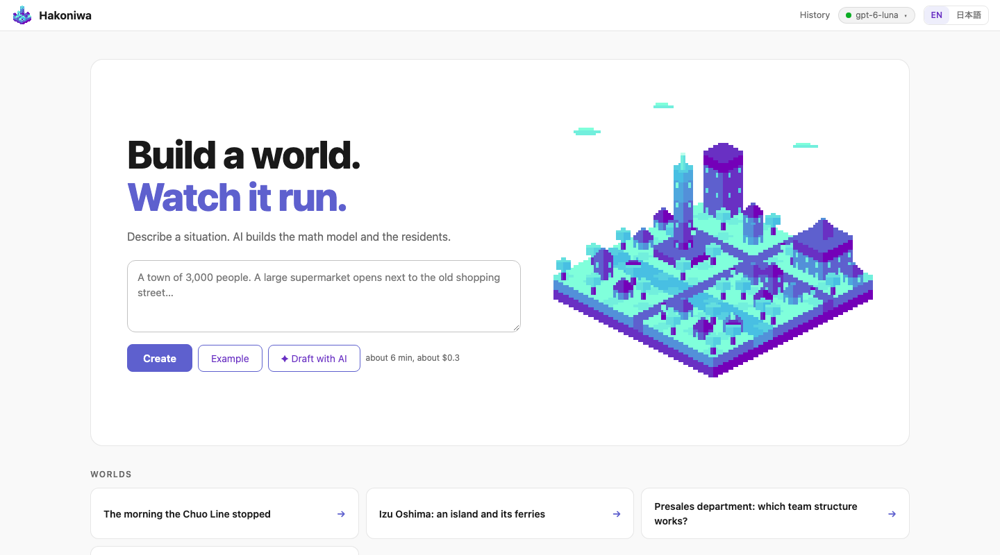
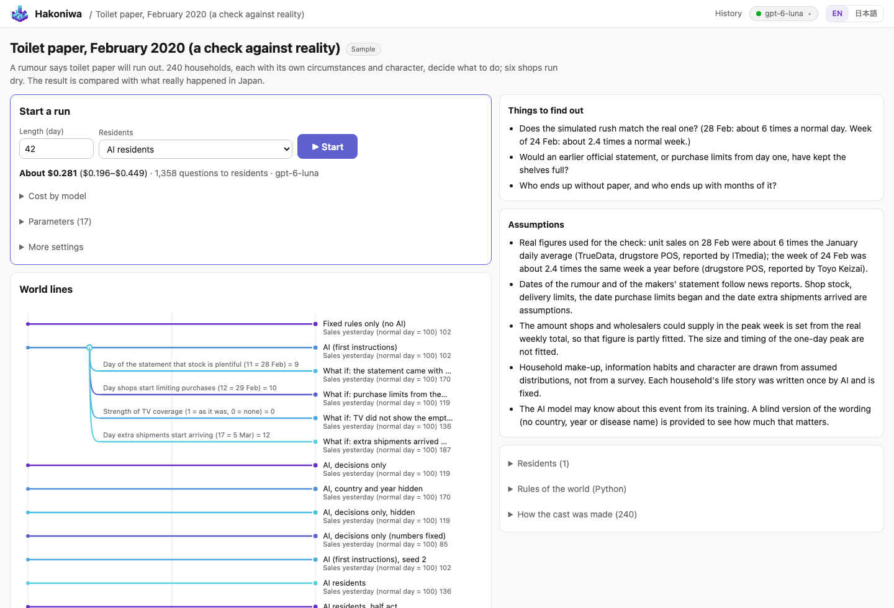
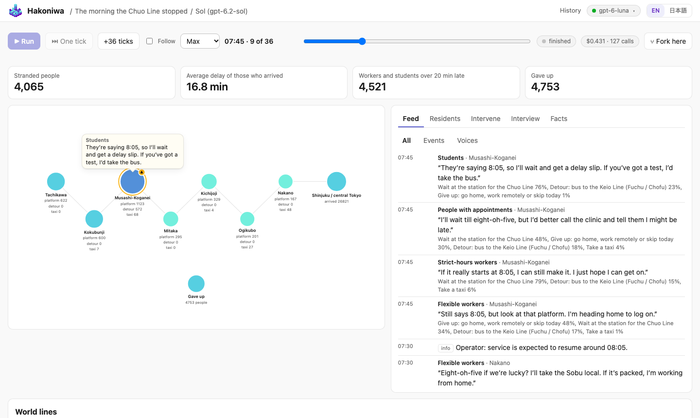
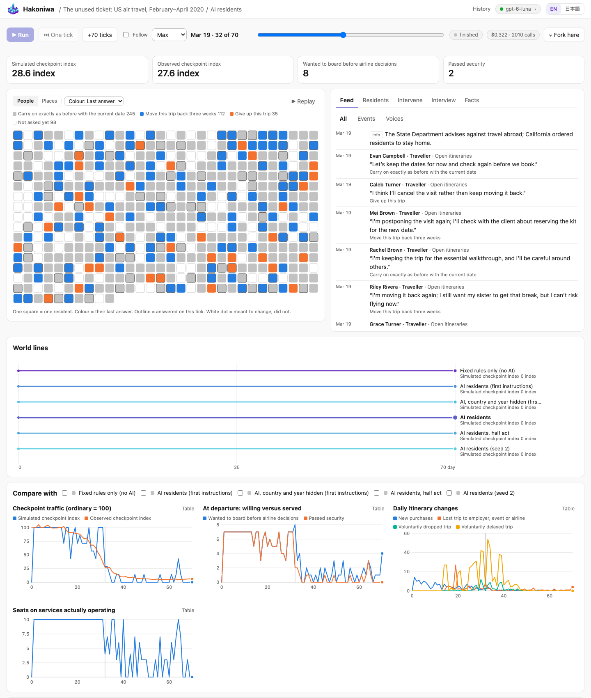
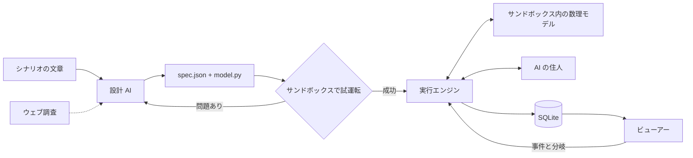

<div align="center">


<h1>Hakoniwa</h1>

<em>数式で動く小さな世界。住人は AI が演じます。状況を書いて世界を作り、動きを眺め、途中で条件を変えて結果を比べられます。</em>

[](./LICENSE)
[](https://www.python.org/)
[](./docker-compose.yml)
[](#-設定)
[](#-スクリーンショット)

[English](./README.md) | [日本語](./Readme.jp.md) | [設計メモ（日本語）](./docs/DESIGN.ja.md)

</div>

## ⚡ 概要

**Hakoniwa（箱庭）** は、数行の文章から小さな世界を作って、その動きを観察できるシミュレーターです。

- **数式が世界を動かす。** 人数、金額、行列、受け入れ上限などを Python のモデルで表し、1 ティックずつ進めます。
- **AI が住人を演じる。** 判断が必要なときに、個人や集団にどう行動するかを尋ねます。回答を数理モデルに反映し、住人の発言も記録します。
- **観察しながら介入できる。** 実行を一時停止し、パラメータを変えたり、事件を起こしたりできます。任意のティックから分岐し、同じグラフ上で結果を比較できます。
- **シナリオから世界を作る。** 設計 AI がパラメータ、住人、数理モデルを作成します。サンドボックスで試運転し、問題があれば修正します。

実行データはローカルの SQLite ファイルに保存し、数理モデルはサンドボックスで動かします。AI を使うときは API に接続します。通常の実行にかかる費用は数セント程度です。

> シミュレーションは、設定した条件からどんな結果が生じるかを見るためのものです。サンプルの数値は、出典が記載されているものを除き、仮定です。

## 📸 スクリーンショット

<div align="center">
<table>
<tr>
<td></td>
<td></td>
</tr>
<tr>
<td></td>
<td></td>
</tr>
</table>
</div>

## 🧪 サンプル

3 つの世界を同梱しています。表の呼び出し回数と費用は、住人に `gpt-6-luna` を使った各 1 回の実行結果です。

| 世界 | 1 ティック | 試せること | AI 呼び出し回数 | 費用 |
|---|---|---|---|---|
| **中央線が止まった朝**。7 駅の通勤客が、待つ、迂回する、タクシーに乗る、移動を諦める、のいずれかを選びます。 | 5 分 | 正確な運転再開時刻を早めに知らせる。迂回路線の輸送力を増やす。 | 127 | $0.03 |
| **伊豆大島：島の経済とフェリー**。観光客、宿、商店、漁師、島の若者、船会社が登場します。 | 1 週間 | 高速ジェット船を倍増する。航路の採算や島の人口はどう変わるか。 | 80 | $0.01 |
| **プリセールス部：どのチーム編成がうまくいくか**。4 種類の組織体制で、案件、技術者、営業担当者、顧客の動きをシミュレーションします。 | 1 営業日 | 組織を再編する。GPU 需要を倍にする。主力のシニア技術者が抜ける。 | 150 | $0.03 |

大型スーパーの出店を迎える商店街について、6 行の文章から AI が世界を設計した例では、463 行のモデルに 25 個のパラメータと 7 種類の住人が含まれました。サンドボックスでの試運転は初回で通り、設計に約 6 分、$0.32 かかりました。

<details>
<summary>ラフなアイデアからシナリオを作る例</summary>

**AI でシナリオを考える**を押すと、アイデアを世界の設計に使える文章に整えます。

**アイデア**「ラーメン屋の行列。値上げしたらどうなるか見たい。」

**下書き**「駅前のラーメン店。カウンターは 12 席、スタッフは 3 人で、店の外には 15 人まで並べる。平日 5 日間の 11:00〜14:00 を、1 分刻みでシミュレーションする。昼休み中の会社員や学生は、値段と行列を見て並ぶか他店に行くかを決め、残り時間が少なくなると列を離れる。スタッフは客を席に案内し、注文順に調理しながら役割分担を見直す。来店人数、行列の長さ、待ち時間、空席、提供した杯数、売上を毎分記録する。850 円を維持する場合、週の途中で 950 円に上げる場合、値上げを前日に告知する場合を比べる。行列は短くなるか。並ぶのを諦める人は減るか。昼の売上は増えるか。」

</details>

## 🔄 シミュレーションの流れ



各ティックでは、まず数式に従って状態を進め、誰の判断が必要かをモデルが列挙します。AI の住人が並行して回答し、検証を経た回答をモデルに反映します。ティックごとにスナップショットを保存するため、あとから任意のティックで分岐できます。

## 🚀 クイックスタート

### Docker で起動する（推奨）

世界のモデルを実行する専用コンテナはネットワークから隔離され、機密情報にはアクセスできません。ファイルシステムは読み取り専用です。

```bash
cp .env.example .env        # .env の OPENAI_API_KEY にキーを設定
docker compose up --build   # http://localhost:8787
```

### ソースから起動する

#### 必要なツール

| ツール | バージョン | 用途 | 確認コマンド |
|---|---|---|---|
| Python | 3.11 以上 | エンジンとビューアーの実行 | `python3 --version` |
| uv | 最新版 | 依存パッケージのインストール | `uv --version` |
| Docker | 任意 | AI が書いたモデルを世界ごとに一時コンテナで実行 | `docker version` |

#### 1. 設定する

```bash
cp .env.example .env        # .env の OPENAI_API_KEY にキーを設定
```

#### 2. インストールする

```bash
uv venv --python 3.12
uv pip install fastapi uvicorn httpx
```

#### 3. 起動する

```bash
PYTHONPATH=. .venv/bin/python -m hakoniwa   # http://127.0.0.1:8787
```

API キーなしでもサンプルの世界を実行できます。その場合、住人はモデルで定めた既定の行動を取り、外部への通信は発生しません。

## 🖥 ビューアーの使い方

日本語で開くには、起動後にブラウザーで `http://127.0.0.1:8787/?lang=ja` にアクセスします。

1. **世界を作る。** トップページでシナリオを書き、**作る**を押します。ラフな案から始めるなら**AI でシナリオを考える**を使えます。既存の世界は一覧から開けます。
2. **実行する。** 長さを設定し、ボタンの下に表示される費用を確認して、**実行を始める**を押します。
3. **観察する。** 実行が進むと地図、主要指標、グラフ、できごとが更新されます。スペースキーで一時停止・再開し、`←` と `→` でティックを移動できます。
4. **介入する。** **介入**タブから、事件を起こしたり、パラメータを変更したりできます。分岐すると、元の実行を保存したまま新しい実行が始まります。
5. **比較する。** 分岐のグラフには分岐元の値も表示されます。**比べる相手**でほかの実行を追加できます。**世界線**では、どこで分岐したか、分岐時に何を変えたか、各実行がどこで終わったかを確認できます。
6. **質問する・まとめる。** **インタビュー**で住人に質問し、**レポートを書く**で実行のまとめを作成できます。
7. **履歴を見る。** 右上の**履歴**に、すべての実行と費用が表示されます。
8. **モデルを選ぶ。** 右上のモデル名をクリックすると、世界の設計、住人、レポートに使うモデルと考える深さを設定できます。

世界のページの**レポートをダウンロード（.md）**から、シナリオ、前提、各実行の結果と最新の保存済みレポートを、画面で選んでいる言語で保存できます。ダウンロード時に AI は呼び出しません。

**データ**では、世界、実行や分岐の履歴、レポート、保存されたモデル設定を SQLite ファイルに書き出したり、バックアップから取り込んだりできます。取り込むと現在のデータがすべて置き換わります。実行は一時停止し、進行中の処理が終わってから操作してください。

コマンドラインからも操作できます。

```bash
python -m hakoniwa worlds
python -m hakoniwa estimate izu_oshima --ticks 104
python -m hakoniwa run chuo_line --report
python -m hakoniwa run presales --params '{"org_model": "product_squads"}' --no-ai
python -m hakoniwa check        # すべての世界をサンドボックスで検証
```

## ⚙ 設定

設定は `.env` に記述します。

| 環境変数 | 既定値 | 用途 |
|---|---|---|
| `OPENAI_API_KEY`, `OPENAI_BASE_URL` | 未設定、`https://api.openai.com/v1` | Chat Completions 互換 API の接続設定 |
| `HAKONIWA_MODEL_DESIGNER`, `HAKONIWA_EFFORT_DESIGNER` | `gpt-6.2-sol`, `medium` | シナリオから世界を設計するモデルと考える深さ |
| `HAKONIWA_MODEL_AGENT`, `HAKONIWA_EFFORT_AGENT` | `gpt-6-luna`, `low` | 実行中の住人の判断と発言に使う設定。短い呼び出しが多数発生します。 |
| `HAKONIWA_MODEL_REPORT`, `HAKONIWA_EFFORT_REPORT` | `gpt-6.2-sol`, `low` | レポートの作成に使う設定 |
| `HAKONIWA_RESEARCH` | `none` | `responses` を指定すると、設計時に OpenAI Responses API でウェブ検索します。 |
| `HAKONIWA_SANDBOX` | `auto` | `docker`、`remote`（Compose の専用コンテナ）、`process`（プロセスの隔離なし）から選べます。 |
| `HAKONIWA_LLM` | `auto` | `mock` を指定すると AI なしで動きます。 |
| `HAKONIWA_LANGS` | `en,ja` | 住人が話す言語 |

ビューアーで保存したモデルと考える深さは、`.env` より優先されます。**.env の設定に戻す**で元に戻せます。
役割ごとに別の API プロバイダーを使うには、`HAKONIWA_AGENT_BASE_URL` と `HAKONIWA_AGENT_API_KEY` を設定します。設計とレポートについても、`AGENT` をそれぞれ `DESIGNER`、`REPORT` に置き換えて設定できます。
費用の見積もりは `prices.json` の単価を使います。使うモデルの単価が未登録の場合は、ここに追加してください。

## 🧱 アーキテクチャ

```text
hakoniwa/
  domain/          世界モデルの仕様、判断、料金計算などのルール（入出力なし）
  application/     実行エンジン、世界の設計、費用見積もり、観察、ports.py
  infrastructure/  SQLite、サンドボックス、OpenAI 互換クライアント、設定
  interface/       HTTP API、CLI、ウェブビューアー
  worlds/          サンプルの世界（spec.json と model.py）
  bootstrap.py     ポートにアダプターを接続
sandbox/           世界モデルのランナー、コンテナイメージ、専用サーバー
tools/             make_icon.py が 10 色の配色で街のアイコンとアニメーションを生成
```

`interface` と `infrastructure` は `application` に依存し、`application` は `domain` に依存します。1 つのサーバープロセスが API とビューアーを提供します。実行はバックグラウンドで進むため、ブラウザーを閉じても続きます。

### 世界モデルの仕様

1 つの世界は、パラメータ、住人、指標、グラフ、事件を定義する `spec.json` と、以下の関数を持つ `model.py` で構成します。

```python
init(params, rng) -> state                     # JSON に変換できる辞書
step(state, params, rng, t) -> events          # 数式に従って 1 ティック進める
decisions(state, params, t) -> requests        # 判断が必要な住人を列挙する
apply(state, params, rng, t, action) -> events # 回答を状態に反映する
metrics(state, params, t) -> {id: number}
view(state, params, t) -> {clock, nodes, links} # ビューアーに表示する地図
invariants(state, params, t) -> [problems]     # 保存則などを検証する
on_params(state, params, patch, t) -> events   # 実行中のパラメータ変更を反映する
```

各判断リクエストの `default` には、AI を使わない場合の行動を指定します。モデルは既定の行動だけでも妥当な挙動をする必要があります。この挙動を使って、実行前に AI なしで試運転し、費用を見積もります。

## 🔒 安全性

- ビューアーにはログイン機能がなく、`127.0.0.1` で待ち受けます。外部に公開しないでください。
- AI が書いたモデルは、ネットワークと機密情報へのアクセスを遮断し、ファイルシステムを読み取り専用にして CPU とメモリを制限したサンドボックスで実行します。`process` バックエンドには隔離機能がなく、`HAKONIWA_ALLOW_UNSAFE_SANDBOX=1` を明示した場合に限り、AI が書いたモデルを実行します。
- **その他の設定**にある**この金額で止める（USD）**に達すると、その実行での AI 呼び出しを停止します。

## 🧪 テスト

```bash
uv pip install pytest pytest-asyncio
HAKONIWA_LLM=mock PYTHONPATH=. .venv/bin/python -m pytest -q
```

## 📄 謝辞

Hakoniwa は、ソーシャルプラットフォーム上で多数の AI エージェントを動かす [MiroFish](https://github.com/666ghj/MiroFish) に着想を得ました。Hakoniwa では、世界の状態を数値として表し、数式で更新します。AI を呼び出すのは、住人の判断が必要な場面です。

## 📜 ライセンス

[MIT](./LICENSE)
