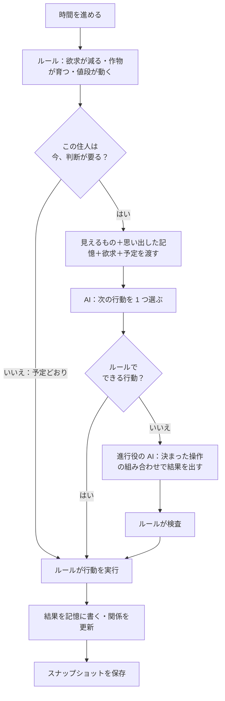

# 生活する箱庭：調査と設計案

作成日：2026-11-26。まだ実装していません。調査の数字は、論文の要旨と紹介記事から取ったものです。本文は読み切れていないので、細かい数字は要確認です。

## 1. 結論

**できます。** ただし、今の Hakoniwa とは作りを変える必要があります。

| | 今の Hakoniwa | やりたいこと |
|---|---|---|
| 主役 | 数字（数式が世界を進める） | 住人（1 人ずつが自分で動く） |
| AI の出番 | 節目だけ。「待つ 30%、迂回 50%」のように割合で答える | 毎日の生活。どこへ行く、何を作る、誰と話す、を自分で決める |
| 世界 | 数理モデル 1 本 | 場所・物・道具・お金・決まりごとがある世界 |
| 見えるもの | 集計の推移 | 1 人ずつの暮らしと、そこから生まれる社会 |

数理モデルは捨てません。世界の中の「仕組み」として使います（物の値段、作物の育ち、天気など）。住人の行動まで数式にしようとしたのが、今の方式の限界でした。

## 1.5 追記（2026-11-26）：予測と生活を融合させる形

ご要望（融合させたい、数年先まで動かしたい、世界はオートマトンでよい、現実の出来事で確かめたい、世界線は残したい）を受けて、次の形を試しました。結果は `docs/VALIDATION-tp2020.ja.md` と `docs/reports/`（英語、3 件）にあります。

| 部品 | 中身 | 現実に合わせられるか |
|---|---|---|
| 世界のオートマトン | 状態と、状態を進める規則。店の在庫、配送、情報の伝わり方 | **合わせられる。** 規則の中の数字を実データから決める |
| 住人のオートマトン | 1 人ずつの小さな規則（いつ・どれだけ・どれくらい急いで） | 普段の動きは合わせられる |
| AI | 節目で、その人の規則を書き換える。人物像と生い立ちを踏まえて | 合わせにくい。だから実際の出来事で照合する |
| 世界線 | 照合できた実行から分岐して、「もし〜だったら」を見る | — |

**現実との照合（3 件、各 1 回ずつの実行）**

| 出来事 | 世界を組んだのは | 合ったところ | 合わなかったところ |
|---|---|---|---|
| トイレットペーパー（日本、2020 年 2 月） | 手書き（最初の試し） | ピークの日（2/28）。AI の住人だと 4〜5 週間で落ち着く | 1 日の販売 510（実際は約 600）。店の在庫の仮定が上限になった |
| 給油所の行列（英国、2021 年 9 月） | ツール（Astra 6.2） | ピークの日（9/24）、その後数週間の反動減、在庫の動き（相関 0.93） | ピーク 233 と 249（2 回の実行、実際は 191）。聞き方を直す前は 305。規則だけなら 208 |
| 航空旅行の急減（米国、2020 年 2〜4 月） | ツール（Astra 6.2） | 3 月下旬にほぼゼロになる流れ（週次の相関 0.96〜0.98） | 減り始めは 1 回は 1 日早く、もう 1 回は 8 日早い（直す前は 9 日早い、規則だけは 7 日遅い）。3/16 の週が高すぎる |

分かったこと：

- 時期と形は合う。**反応の大きさ**が弱点。最初、AI の住人は現実の人より早く、そろって動いた。
- 人物像は効く（外すと欲しがる量が 1.5 倍）。ただし一番効いたのは**聞き方**。「規則の答えを真似るな」をやめ、「多くの人はたいていの日は何も変えない。規則の答えがありそうな答えで、その人なりの理由があるときだけ外れる」にした（今の既定）。
- 規則の答えを隠して「何も変えない人が多い」とだけ伝えると、トイレットペーパーでは逆に動かなすぎた。一律に抑えればよいわけではない。
- 関門（考える人だけに聞く）と摩擦（考えを変えても実行しない人がいる）も実装した。今の聞き方では不要で、既定は切ってある。
- 質問に「これまで通りにする」の選択肢を入れると、住人の動きがばらける（英国の 1 回目は 200 人中 197 人が同じ選択、2 回目は 427 人中 202 人が「これまで通り」）。
- 売れた量は在庫で頭打ちになるので、「欲しかった量」を別に記録する。
- 実データのうち、入力に使う列と、検証だけに使う列を分ける。
- 1 日あたりの行動が少ないと指数が粗くなる（米国は 1 日約 7 人）。50 件以上になるように組む。

これらは世界を組むモデルへの指示（`DESIGNER_SYSTEM`）に書き足してあります。

**費用を決めるもの**

```
費用 ≒ 住人の数 × 1 人に聞く回数 × 1 回の料金
```

シミュレートする期間の長さは、ほとんど効きません。オートマトンが進める分は無料だからです。

| 規模 | 聞く回数 | 通常の AI（Luna） | 判断だけ（Decisions API） |
|---|---|---|---|
| 240 人 × 6 週間（今回の実測） | 約 1,100 回 | $0.24 | $0.16 |
| 240 人 × 5 年、月 1 回の見直し ＋ 出来事 | 約 1 万 6,000 回 | 約 $3.5 | 約 $2.4 |
| 1,000 人 × 5 年、月 1 回 ＋ 出来事 | 約 6 万 5,000 回 | 約 $14 | 約 $10 |
| 240 人 × 5 年、週 1 回 | 約 6 万 2,000 回 | 約 $14 | 約 $9 |

2 行目以降は、今回の実測（1 回あたり通常 $0.00022、判断だけ $0.00015）からの単純な掛け算です。

**聞くかどうかの決め方**

1. まず規則が決めます（新しいことを知ったとき、状況が大きく変わったとき、決めた周期）。無料です。
2. 微妙な場面は、判断モデルに「この人の行動は変わるか」を聞いて、変わるときだけ本体を呼ぶ、という形にできます。OpenAI の Decisions API は今回つなぎ込みました（Cloudflare の Clef、TypeSafeAI の Jev も同じ種類のモデルです）。
3. 今回の実験では、Decisions API に行動そのものを決めさせました。選択肢を選ぶのは速くて安いですが、自由な数値を決めさせると真ん中に寄る癖が出ました。見張り役（2 の使い方）のほうが向いています。これは未実装です。

## 2. 先行研究で分かったこと

| 研究 | やったこと | ここから取り入れること |
|---|---|---|
| Generative Agents（Stanford、2023） | 2D の町に 25 人。記憶の流れ、振り返り、計画の 3 つで「人らしい暮らし」を出した | 住人の頭の作り（記憶 → 振り返り → 計画 → 行動） |
| Project Sid（Altera、2024） | Minecraft に 10〜1,000 人以上。役割の分化、ルールの変更、文化や宗教の広まりが起きたと報告 | 「起きたこと」の測り方（役割の分かれ方、情報の広まり方）。ただし著者自身が「予備的な結果」と書いている |
| Concordia（Google DeepMind、2023） | 進行役（Game Master）が世界を持つ。住人は文章で意図を言い、進行役が結果を決めて、お金などの数字を検査する | 「数字は世界側が管理し、住人は意図を出すだけ」という分担 |
| AgentSociety（清華大、2025） | 都市・社会・経済の環境に 1 万人以上、約 500 万回のやり取り。感情・欲求・動機を持たせた | 欲求と感情を数字で持たせる作り。移動・経済を別の仕組みで動かす作り |
| Humanoid Agents（2023） | 空腹・体力・健康、感情、親しさを足すと、行動と会話が変わった | 欲求は数字でルールが動かし、AI にはその数字を見せる |
| Lyfe Agents（2023） | 呼び出しを減らす工夫で、1 人 1 時間あたりの費用を約 50 分の 1 にした（当時の料金で $25 → $0.5 と報告） | 「高い判断」と「細かい動作」を分ける。細かい動作は AI を呼ばない |
| Affordable Generative Agents（2024） | 環境とのやり取り、住人同士のやり取りの両方で費用を下げた | 同じ状況の行動は使い回す |
| Mindcraft（オープンソース） | 本物の Minecraft で LLM の住人を動かす。47 個の道具を呼べる | 行動は「決まった道具を呼ぶ」形にする |

**批判として挙がっていること**（複数の調査論文）

- AI の住人は、人間より**ばらつきが小さい**（「平均的な人」になりがち）。
- **対立を避け、同意しやすい**。反対意見が出にくい。
- 人間より**流されやすい**。
- 1 人ずつの小さなずれが、やり取りを重ねると「偽の合意」に育つ。
- 結果は、指示文の書き方に左右される。

つまり、「現実の予測」には使えません。「もしこういう人たちがこういう世界にいたら、何が起きうるか」を眺める道具、という位置づけが正しいです。これは今の Hakoniwa と同じです。

## 3. 作り方の 3 案

| 案 | 中身 | 良いところ | 困るところ |
|---|---|---|---|
| A. 本物の Minecraft | Minecraft のサーバーを立てて、Mindcraft などで住人を入れる | 世界が最初から作り込まれている。見て楽しい | 重い（Java のサーバー、住人 1 人ごとに接続）。実時間でしか進まない。分岐や巻き戻しができない。住人は「木を切る」などの動作に多くの呼び出しを使う |
| B. 自前の軽い世界 | 場所・物・レシピ・欲求・お金を持つ世界を、ルールで動かす。住人は決まった行動を選ぶ | 速い。安い。保存・分岐・比較ができる。今の基盤をそのまま使える | 世界の中身を作る必要がある（→ AI に作らせる） |
| C. 文章だけの世界 | 進行役の AI が、文章で世界を語る（Concordia の形） | 何でも起こせる | 辻褄が崩れやすい。費用が高い。数字で比べにくい |

**おすすめは B を土台に、C を少し混ぜる形です。**

- 普段の行動（移動、作る、売り買い、話す、寝る）は、ルールが処理します。
- ルールにない行動（「祭りを開きたい」「店の決まりを変えたい」）だけ、進行役の AI が受け付けます。進行役も、世界を直接書き換えられません。決まった操作（物を動かす、お金を動かす、決まりごとを足す）の組み合わせで結果を出し、ルール側が検査します。
- 「全部を作り込むのは難しい」という問題は、**世界の中身を AI に書かせる**ことで解きます。今の「AI が数式のコードを書く」より安全で確実です。AI が書くのはコードではなく、決まった形のデータ（場所の一覧、物の一覧、レシピ、仕事、住人の人物像）だからです。

A（本物の Minecraft）は、B ができたあとの追加にできます。住人の頭の部分は同じものを使い、世界とのつなぎ目だけを差し替えます。

## 4. 設計

### 4.1 世界

| 部品 | 中身 | 動かすもの |
|---|---|---|
| 地図 | 場所（家、畑、店、広場、工房、森…）と、そのつながり。場所ごとに広さと置ける物 | ルール |
| 物 | 食べ物、材料、道具、建物。持ち主と置き場所を持つ | ルール |
| レシピ | 「小麦 2 ＋ かまど → パン 1、30 分」のような作り方 | ルール |
| 欲求 | 空腹、体力、人付き合い、安心、お金。時間で減り、行動で回復する | ルール（数式） |
| 時間 | 1 ティック = 10〜15 分。昼と夜、曜日、季節 | ルール |
| 仕組み | 値段（需要と供給）、作物の育ち、天気、病気 | **数理モデル**（今の資産を使う） |
| 決まりごと | 税、店の営業時間、禁止事項、役職。住人が話し合いで変えられる | ルール ＋ 進行役 |

状態は、今と同じく「そのまま保存できる辞書」にします。ティックごとにスナップショットを取るので、世界線の分岐と比較がそのまま使えます。

### 4.2 住人

1 人ずつが、次のものを持ちます。

| 部品 | 中身 |
|---|---|
| 人物像 | 名前、年齢、仕事、性格（5 つほどの軸を数字で）、生い立ち、大事にしていること、苦手なこと、口ぐせ |
| 技能 | 料理、農業、大工、商売など。数字で持ち、使うと伸びる |
| 関係 | 相手ごとの親しさ・信頼。出来事で上下する（今の「時間つきの事実」の表を使う） |
| 欲求 | 4.1 の数字。本人には「空腹でつらい」のように言葉でも見せる |
| 記憶 | 見たこと・したこと・聞いたことを、時刻と大事さを付けて貯める。時間つきの知識グラフとして持つ（下で説明） |
| 振り返り | 1 日の終わりに、記憶をまとめて「考え」にする（例：「ケンは約束を守らない」）。性格と目標も少しずつ変わる |
| 計画 | 朝に 1 日の予定を立てる。出来事があれば立て直す |

**記憶は「時間つきの知識グラフ」で持ちます。**（LayerX の記事と、そこで紹介されている Graphiti / Zep の考え方を取り入れます）

| 層 | 中身 | 例 |
|---|---|---|
| できごと | 見たこと・したこと・聞いたことを、そのまま時刻つきで残す | 「3 日目 14:00、広場でケンがパンを値上げすると言った」 |
| 事実 | 「誰が・何を・どうである」を、いつからいつまで真かと一緒に持つ。変わったら上書きせず、古いほうに終わりの時刻を入れる | 「パンの値段 = 120（1 日目〜3 日目）」「パンの値段 = 150（3 日目〜）」 |
| まとめ | 夜の振り返りで作る、人や場所ごとの要約 | 「ケンは最近お金に困っているらしい」 |

- **グラフは住人ごとに持ちます。** 同じ出来事でも、知っている人と知らない人がいます。古い情報や、間違ったうわさを信じたままの人も出ます。これで「うわさがどう広まったか」「誰がいつ知ったか」を後から調べられます。
- **保存先は今の SQLite です。** 今ある「時間つきの事実」の表を、住人ごとに持てるように広げます。外部のサービスやグラフ用のデータベースは足しません。
- **思い出し方**は、キーワード検索、関係をたどる検索（今いる場所や目の前の相手から 1〜2 歩）、新しさと大事さ、の 3 つを合わせて順位を付けます。「3 日前の時点で何を信じていたか」も引けます。
- **記事が挙げている一番の難所は「同じ人や物を別物として登録してしまうこと」です。** この設計では起きにくくなります。人・場所・物の ID は世界の側が最初から持っていて、行動の結果はルールが「誰が何をした」の形で渡すからです。AI に文章から抜き出させるのは、会話と振り返りだけにします。そのときも、相手や物は ID の一覧から選ばせます。
- Graphiti をそのまま使う手もあります（組み込み型のグラフ DB で、ローカルで動かせます）。ただ、取り込みのたびに AI を何回も呼ぶ作りなので、住人の数 × できごとの数だけ費用が増えます。まずは上の自前の形で始めるのが良いと考えます。

**ばらつきを出す工夫**（批判への対策）

- 性格を数字で散らし、人物像に「譲れないこと」「嫌いな相手のタイプ」を必ず入れる。
- 物と時間を足りなくする。全員が満たされる世界では、対立が起きません。
- 記憶は全部を渡さず、思い出せた分だけ渡す。人によって見えている世界が違うようにする。
- 住人ごとに使うモデルや「考える深さ」を混ぜられるようにする。

### 4.3 1 ティックの流れ



**判断が要る場面**は、次のときだけです。

- 朝（1 日の予定を立てる）。
- 予定の行動が終わった、または実行できなかった。
- 近くで何かが起きた（話しかけられた、物がなくなった、知らせが届いた）。
- 欲求が限界に近づいた。

それ以外のティックは、予定どおりにルールが進めます。ここが費用を抑える一番の工夫で、先行研究（Lyfe Agents、Affordable Generative Agents）と同じ考え方です。

**会話**は、2 人が同じ場所にいて、どちらかが話しかけたときに始まります。1 往復ごとに AI を呼び、最大 6 往復ほどで切ります。終わったら、要点だけを 2 人の記憶に書きます。

### 4.4 AI を呼ぶ場面と、使うモデル

| 場面 | 頻度（1 人 1 日） | モデルの目安 |
|---|---|---|
| 朝の予定 | 1 回 | 住人用（安いモデル） |
| 行動の判断 | 20〜30 回 | 住人用 |
| 会話 | 5〜8 回 × 数往復 | 住人用 |
| 夜の振り返り | 1 回 | 賢いモデル（人物の変化を左右するため） |
| 進行役 | 世界全体で 1 日 数回〜数十回 | 賢いモデル |
| 1 日の新聞 | 世界全体で 1 回 | レポート用 |

### 4.5 費用の見積もり

料金は今の既定のモデル（Luna：$0.10 / $0.50、Sol：$2 / $10、100 万トークンあたり）で計算しています。1 回あたりのトークン数は仮定です。実際に走らせて測り直す必要があります。

| 規模 | 行動 | 会話 | 振り返り（Sol） | 合計の目安 |
|---|---|---|---|---|
| 20 人 × 3 日 | 1,500 回、約 $0.6 | 約 2,200 往復、約 $0.6 | 60 回、約 $1.1 | **約 $2〜3** |
| 50 人 × 7 日 | 8,750 回、約 $3.3 | 約 12,600 往復、約 $3.5 | 350 回、約 $6.3 | **約 $13〜15** |
| 100 人 × 7 日 | 約 $6.6 | 約 $7 | 約 $12.6 | **約 $26**（予算超え。振り返りを安いモデルにすれば約 $15） |

仮定：行動 1 回 = 入力 2,500・出力 250 トークン。会話 1 往復 = 入力 2,000・出力 150。振り返り 1 回 = 入力 6,000・出力 600。

ご希望の $1〜20 に収まるのは、**20〜50 人が数日〜1 週間暮らす**規模です。

### 4.6 世界の中身を AI に作らせる

シナリオの文章から、設計役の AI が次を書きます。コードは書かせません。

1. 場所の一覧とつながり（地図）。
2. 物とレシピ。
3. 仕事と、仕事ごとの 1 日の流れ。
4. 欲求の種類と、減り方・回復のしかた。
5. 最初の決まりごと。
6. 住人の人物像（人数分。家族や友人などの関係も）。
7. 観測する指標。

そのあと、ルールだけで空回しして検査します（全員が飢え死にしないか、作れない物がないか、行けない場所がないか）。壊れていたら直させます。今の「試運転 → 修理」の流れと同じです。

### 4.7 観測

| 画面 | 見えるもの |
|---|---|
| 箱庭 | 斜め上から見た地図の上を、住人が歩く。吹き出しで発言。アイコンで作ったドット絵の描き方をそのまま使う |
| 住人 | 1 人を選ぶと、人物像、欲求、今日の予定、最近の記憶、考え、関係が見える |
| 新聞 | 1 日ごとに、起きたことを AI がまとめる |
| 社会の数字 | 持ち物の偏り、仕事の分かれ方、知り合いのつながり、うわさの広まり方、決まりごとの変化 |
| 世界線 | 今と同じ。分岐して比べる |

### 4.8 介入

- 出来事を起こす（嵐、よそ者が来る、祭り、物の不足）。
- 決まりごとを変える。
- 住人の耳元でささやく（本人は「ふと思いついた」と受け取る）。
- 住人を足す・外す。

どれも、分岐して比べられます。

## 5. 今の Hakoniwa との関係

世界の種類を 2 つにします。

| 種類 | 中身 | 向いていること |
|---|---|---|
| 数理の世界（今あるもの） | 数式 1 本 ＋ 節目で答える住人 | 大人数の流れ（通勤、観光、需要）。安くて速い |
| 生活する世界（今回の案） | ルールで動く世界 ＋ 自分で動く住人 | 少人数の暮らしと、そこから生まれる社会 |

そのまま使えるもの：保存の仕組み、実行と分岐、世界線、費用の見積もり、モデルの選択、住人の名前、画面の土台。
新しく作るもの：世界のルールエンジン、住人の頭（記憶・振り返り・計画）、進行役、箱庭の地図の画面、住人を見る画面。

AI が書くのがコードではなくデータになるので、サンドボックスは「生活する世界」では要りません。

## 6. 分かっている弱点

| 弱点 | 対策 | 残る限界 |
|---|---|---|
| 住人が似てくる、仲良くなりすぎる | 4.2 の工夫 | 完全には消えない。同じ設定で何回か走らせて、幅を見る |
| 同じ行動を繰り返す | 「直近と同じ行動」を検出して、振り返りを前倒しする | まれに残る |
| 世界にない物や場所を言い出す | 行動は決まった道具だけ。進行役の結果もルールが検査 | 会話の中の作り話は止められない（記憶には「聞いた話」として残す） |
| 費用と時間 | 判断が要る場面だけ呼ぶ。予算の上限で止める | 50 人 × 1 週間で、数十分〜1 時間ほどかかる見込み（要測定） |
| 結果の正しさを確かめられない | 予測としては使わない、と明記する | 根本的な限界 |

## 7. 進め方の案

| 段階 | 作るもの | 確かめること |
|---|---|---|
| 1 | 手で作った小さな村（12 人、場所 10、行動 10 種類）。欲求、記憶、予定、会話。箱庭の地図の画面 | 3 日間、破綻せずに暮らせるか。費用は見積もりどおりか |
| 2 | 振り返り、関係、新聞、住人を見る画面 | 人物が変化するか。見ていて面白いか |
| 3 | シナリオから世界の中身を AI が作る | 違う題材（島、学校、商店街）でも動くか |
| 4 | 進行役、決まりごとの変更、数理の仕組み（値段、作物） | 役割の分化や制度の変化が起きるか |
| 5（任意） | 本物の Minecraft へのつなぎ込み | — |

段階 1 だけでも、「住人が勝手に生活する」は見られます。

## 8. 決めてほしいこと

1. **案 B（自前の軽い世界）で進めてよいか。** 本物の Minecraft を最初からやりたい場合は、進め方が大きく変わります。
2. **最初の世界の題材。** 例：山あいの村、離島、開拓地、商店街、宇宙船の中。
3. **最初の規模。** おすすめは 12 人 × 3 日（見積もりで $1〜2）。

## 出典

- [Project Sid: Many-agent simulations toward AI civilization](https://arxiv.org/abs/2411.00114)（[リポジトリ](https://github.com/altera-al/project-sid)）
- [Lyfe Agents: Generative agents for low-cost real-time social interactions](https://arxiv.org/pdf/2310.02172)
- [Affordable Generative Agents](https://arxiv.org/abs/2402.02053)
- [Humanoid Agents: Platform for Simulating Human-like Generative Agents](https://arxiv.org/pdf/2310.05418)
- [Concordia: Generative agent-based modeling with actions grounded in physical, social, or digital space](https://arxiv.org/abs/2312.03664)（[リポジトリ](https://github.com/google-deepmind/concordia)）
- [AgentSociety: Large-Scale Simulation of LLM-Driven Generative Agents](https://arxiv.org/abs/2502.08691)
- [Mindcraft: Minecraft AI with LLMs + Mineflayer](https://github.com/mindcraft-bots/mindcraft)、[Collaborating Action by Action](https://arxiv.org/pdf/2504.17950)
- [LLM-Based Social Simulations Require a Boundary](https://arxiv.org/html/2506.19806)
- [Are LLM Agents Behaviorally Coherent? Latent Profiles for Social Simulation](https://arxiv.org/html/2509.03736v1)
- [Validation is the central challenge for generative social simulation](https://link.springer.com/article/10.1007/s10462-025-11412-6)
- [Static Sandboxes Are Inadequate](https://arxiv.org/pdf/2510.13982)
- [Poor Man's Agentic Modeling: Simulating Large LLM-Agent Societies on a Laptop](https://arxiv.org/html/2608.11215)
- [Temporal Knowledge Graph で作る！時間変化するナレッジを扱う AI Agent の世界（LayerX エンジニアブログ）](https://tech.layerx.co.jp/entry/tkg-agent)

Generative Agents（Stanford、2023）は、今回の検索では原論文を開いていません。上の説明は、Lyfe Agents の論文での紹介と、私の知識によるものです。
