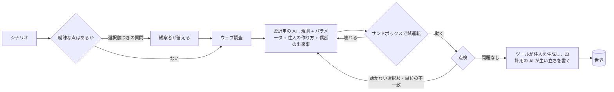
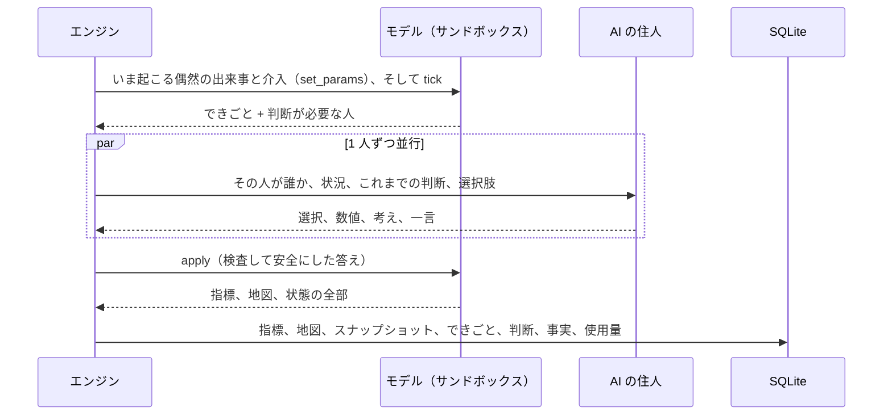

# Hakoniwa 設計メモ

[English](./DESIGN.md)

Hakoniwa は、規則で動く小さな世界に AI の住人を住まわせて、眺める道具です。このメモは v0.2.4 時点の作りを書いています。住人まわりの調査と考え方は [DESIGN-life.ja.md](./DESIGN-life.ja.md)、現実の出来事をどこまで再現できたかは [reports/](./reports/)（英語）にあります。

## 1. 考え方

| 担当 | やること |
|---|---|
| 世界（オートマトン） | 数字をすべて持つ。在庫、行列、お金、誰が何を知っているか。小さな Python のモデルが、決まった規則で 1 ティックずつ進める |
| 住人たち | 数百人の個人。1 人ずつが小さなオートマトンで、数個の値（持っているもの、いまの計画）と生い立ちを持つ |
| AI の住人 | 節目で、その 1 人の判断をする。知らせが届いたとき、何かに失敗したとき、普段に戻ったとき。答えがその人の値を書き換える |
| 観察者 | 眺める。止める。パラメータを変える。1 人に介入する。分岐して、枝を比べる |

この分け方から、次の 3 つが出てきます。

- 世界の状態は「会話の積み重ね」ではなく、規則の下にある数字です。毎ティック保存でき、どのティックからでも分岐でき、記録された数字と比べられます。
- AI に聞くのは、誰かが判断するところだけです。実行の費用はおよそ「人数 × 1 人に聞く回数」で、世界を動かす長さにはほとんど左右されません。
- 乱数の種が同じなら、外から起こる出来事も同じです。枝が親と違うのは、変えたところだけです。

**モードは 2 つ、エンジンは 1 つ。** 数百人の社会のほかに、分かれ道に立つ 1 人の世界（ライフワールド）を作れます。その人はインタビューから作り、そのままモデルに渡します。住人は周りの人たちです。`path` というパラメータは、最初にその人がどうするかだけを決めます。`spec.focus` に、その人・選べる道・見せる結果（満足、後悔、周りからの評価）を書きます。ビューワは、この種の世界を「未来の集まり」として見せます。すべての道を同じ乱数の種で何度か動かして並べ、全体のレポートと、どの未来の自分とも話せる会話を付けます。エンジンに、このモード専用の処理はありません。

## 2. 世界の作られ方

- 世界は、組み立てを始めた時点で ID とページを持ちます。複数を並行して作れます。
- **点検** は、AI なしの無料の試運転です。選択肢を 1 つずつ全員に選ばせます。選んでも何も変わらない選択肢、一度も聞かれない人、動かない数字、単位の合わない実データを見つけます。欠陥は、生い立ちを書く費用をかける前に設計用の AI へ戻します。
- 観察者が貼った実データは、世界と一緒に持ち運ばれます。入力と指定された列は規則を動かします。観測された結果の列は、シミュレーションの数字の横に描くだけで、規則からは読みません。
- できた世界は発展させられます。観察者がその世界への思いを書くと、AI が新しい世界のシナリオに整えます。新しい世界は、もとの世界を覚えています。

## 3. 1 ティックの中身

住人の答えを形づくるもの：

- **その人自身の人物像と生い立ち。** 1 人ずつ違います。これを外すと、住人の反応は 1.5 倍になりました。
- **最初の選択肢は必ず「これまで通りにする」。** エンジンはこれをその人の習慣として扱います。
- **規則が出す答え**（`default`）を「ありそうな答え」として見せます。住人は、その人の性格や事情に理由があるときだけ外れます。指示には「多くの人は、たいていの日は何も変えない」とも書いてあります。
- **言われたことと、身に起きたこと。** 観察者が伝えた言葉と、個人に起きた偶然の出来事は、その後の質問でも状況に残ります。
- 任意の補正が 2 つあり、既定では切ってあります。判断モデルが「そもそも立ち止まって考える人か」を先に見るものと、考えを変えた人の一部だけが実行するものです。

**偶然の出来事。** 世界は「起こりうる出来事」の候補を持ちます。世界全体に起こるもの（しばらくパラメータが変わる）と、一部の人の暮らしに起こるもの（頭に置く一文）があります。何がいつ起こるかは、実行を始める前に乱数の種から決めます。だから分岐しても同じ出来事に出会い、種を変えると別の未来になります。

## 4. 層の分け方（クリーンアーキテクチャ）

依存は内側にだけ向きます。

| 層 | 場所 | 中身 |
|---|---|---|
| domain | `hakoniwa/domain/` | 世界の仕様とコードの検査、判断を安全にする処理、作り方からの住人の生成、偶然の出来事、料金。純粋な関数だけ |
| application | `hakoniwa/application/` | 実行エンジン、世界の設計、点検、費用の見積もり、レポートと質問。外部はすべて `ports.py` の向こう。保存先は約 40 個のメソッドを持つ `Store` というプロトコルで、この層と `domain` は、それが SQLite であることを知りません。別のデータベースにするなら、`infrastructure` にアダプタを足します |
| infrastructure | `hakoniwa/infrastructure/` | SQLite、サンドボックス（Docker・サイドカー・プロセス）、OpenAI 互換のクライアント、設定 |
| interface | `hakoniwa/interface/` | HTTP の API、CLI、ビューワ（素の JavaScript。ビルドなし） |

ドメイン層は薄くしてあります。世界のモデルには DDD を使っていません。状態は普通の辞書、更新は関数です。だから保存・分岐・再生が正確にできます。

## 5. 世界の決まりごと

世界は `spec.json`（パラメータ、住人の種類、指標、グラフ、「もし」の出来事、偶然の出来事）と `model.py`（標準ライブラリだけ）です。データも持てます。住人の一覧と、記録された数字です。

| 関数 | 役割 |
|---|---|
| `init(params, rng)` | 最初の状態。住人は、読める名前のキーを持つ辞書の 1 つのリストに入れる |
| `step(state, params, rng, t)` | 規則で 1 ティック進める |
| `decisions(state, params, t)` | いま判断が必要な人。それぞれに選択肢と `default` |
| `apply(state, params, rng, t, action)` | 答えをその人の状態に入れる |
| `metrics(...)` / `view(...)` | 指標と、場所の地図 |
| `invariants(...)` | 保存則の検査 |
| `on_params(...)` | 途中でパラメータが変わった |

大事な決まり：どの質問にも `default` を付けるので、世界は AI なしでも動きます（費用の見積もり、点検、「規則だけ」の基準に使う無料の試運転）。物理的な限界は規則の中に置きます（タンクは有限、店は無いものを売れない）。「欲しかった量」は「手に入った量」と別に記録します。

## 6. サンドボックス

AI が書いたコードは、次の条件でしか動きません。

| 方式 | 使う場面 | 隔離 |
|---|---|---|
| `docker` | エンジンをホストで動かすとき | 世界ごとに使い捨てのコンテナ。ネットワークなし、読み取り専用、権限なし、メモリと CPU に上限 |
| `remote` | `docker compose` のとき | 外に出られない内部ネットワーク上のサイドカー。世界ごとに新しいプロセス。秘密情報なし |
| `process` | テストと、同梱のサンプル | なし。AI が書いた世界（と、データから読み込んだ世界）は拒否する |

守りは多層です。保存前にコードを検査し（許可した import だけ、`open` や `eval` は禁止）、実行時は組み込み関数を制限し、1 回の操作に時間制限をかけ、残りをコンテナで隔離します。

## 7. データ

SQLite のファイル 1 つです。

| 表 | 中身 |
|---|---|
| `worlds` | 仕様、コード、調査メモ。組み立て中や、作れなかった世界も 1 行 |
| `runs` | 実行。分岐元と分岐したティック、設定 |
| `ticks` | ティックごとの指標と地図 |
| `snapshots` | ティックごとの状態の全部と乱数の状態。どのティックからでも分岐・再生でき、住人の盤面にも使う |
| `events` | 世界のできごと、発言、介入、偶然の出来事 |
| `decisions` | すべての質問と答え、考え、トークン数、費用 |
| `facts` | 有効期間つきの事実（誰の・何が・いつからいつまで） |
| `llm_calls`、`chats`、`reports` | 使用量、インタビューと質問、レポート（言語ごとの Markdown。表はプログラムが作り、短い文章は AI が書く） |

- **データのメニュー。** 選んだ世界と実行を、同じ表を持つ 1 つの SQLite ファイルに書き出せます（既定で gzip 圧縮）。別のデータベースに読み込めます。読み込みで置き換わるものはありません。実行には新しい ID を振り、世界はスラッグで突き合わせるか、空いている名前で追加します。読み込んだ世界は AI が書いたものとして扱うので、そのコードは隔離されたサンドボックスでしか動きません。
- **控えの保存先**（`HAKONIWA_BACKUP_DIR`）。ファイルが残らないマシン向けです。キリのいいとき（実行が止まった、世界ができた、ファイルを読み込んだ）、変更があれば数分ごと、そして終了時にもう一度、圧縮した丸ごとの控えをそのフォルダに書きます。データベースが無いマシンは、その控えから始めます。動いているデータベースそのものは、そのフォルダには置きません。[CLOUD_RUN.ja.md](./CLOUD_RUN.ja.md) を見てください。

## 8. 費用の見積もり

1. AI なしでモデルを 1 回動かします（無料）。質問の回数が正確に数えられます。
2. 質問ごとに本物のプロンプトを組み立てて、入力の量を測ります。
3. 1 回の答えの出力は、そのモデルの実績が 20 回以上あれば実測の平均、なければ仮定の 380 トークンです。
4. 単価は `prices.json` から取ります。低め（× 0.7）と高め（× 1.6）も出します。

本物の住人は展開を変えるので、回数は少しずれます。

## 9. 色

ブランドの色は、濃い紫からミントまでの 10 色です。ドット絵の町とアイコンは、この 10 色だけで描いています。ブロックの側面は 1〜2 段暗い色を使うので、陰影もパレットの外に出ません。

| # | 色 | 使いどころ |
|---|---|---|
| 0 | `#7400b8` | 絵の中のいちばん暗い影 |
| 1 | `#6930c3` | アクセントの文字（ライト）、濃淡の 6 段目 |
| 2 | `#5e60ce` | **アクセント**：ボタン、リンク、見出しの強調語、濃淡の 5 段目 |
| 3 | `#5390d9` | 濃淡の 4 段目 |
| 4 | `#4ea8de` | 濃淡の 3 段目 |
| 5 | `#48bfe3` | 絵の中の水 |
| 6 | `#56cfe1` | 濃淡の 2 段目 |
| 7 | `#64dfdf` | 絵の中の葉 |
| 8 | `#72efdd` | 濃淡の 1 段目、アクセントの文字（ダーク） |
| 9 | `#80ffdb` | ハイライト、明かりのついた窓 |

ビューワでの色の役割：

| 役割 | 色 | 決まり |
|---|---|---|
| 量（どれくらい） | `--seq-1` 〜 `--seq-6`：ブランドの 6 色を薄い順に（ダークでは逆順） | 地図の円、盤面の数値の状態 |
| 区別（どれか） | `--series-1` 〜 `--series-8`：`#257de0` `#f47230` `#00b894` `#f2a600` `#ee7fac` `#008a17` `#6a4ce2` `#ec4647` | グラフの線、比べている実行、盤面の状態や答え。決まった順に割り当て、同じものは同じ色のまま。これはブランドの色ではありません。ブランドの隣り合う色は似すぎていて、線の見分けがつきにくいためです（色覚の違いにも配慮） |
| 「これまで通り」／まだ聞かれていない | `--axis` の灰色で塗る／白地に灰色の枠 | 習慣の答えが、変わった答えと張り合わないように |
| 状態の警告 | `--good #0aac23`、`--warning #fbb315`、`--serious #f18a59`、`--critical #dc3c3d` | 状態だけに使う（▲ 注意、! 危険）。必ず記号を添える。系列の色には使わない |
| 文字と面 | `--text-primary #191919`、`--text-secondary #666666`、`--page #f9f9f9`、`--surface-1 #ffffff`、`--grid #e7e7e7`、`--axis #c2c2c2` | 数字・ラベル・凡例は必ず文字の色。区別は横の色つきの印が担う |

ダークモードは、同じ役割の色を別に選んであります（`style.css`）。自動の反転ではありません。

## 10. 分かっていること

- 現実の出来事を 4 つ再現し、記録された数字と比べました（[reports/](./reports/)）。時期と形は出ます。弱点は人々の反応の大きさで、住人が誰であるかと同じくらい、聞き方で変わります。
- 1 回の実行は 1 つの標本です。種だけが違う 2 回で、何かが始まる時期が 1 週間ずれることがあります。
- 世界は組むたびに違います。同じシナリオを 2 回組むと、規則だけの動きも変わりました。
- 盤面の「最後の答え」の色は、その人が言ったことです。規則が持っている状態ではありません。状態は、盤面の「状態」表示と状態遷移図で見られます。
- インタビューでは、住人の行動は変わりません。1 人への介入なら変わります（分岐として）。
- ビューワにログインはありません。127.0.0.1 のままにするか、手前に本人確認のプロキシを置いてください。
- OpenAI 以外の提供元では、ウェブ調査（Responses API の `web_search`）と判断用の API は使えない見込みです。`HAKONIWA_RESEARCH=none` にします。
