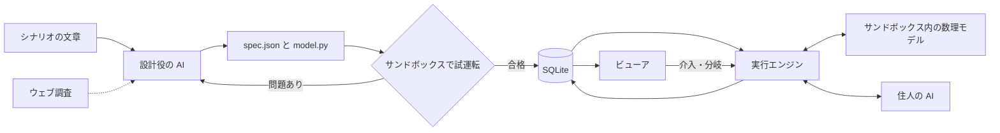
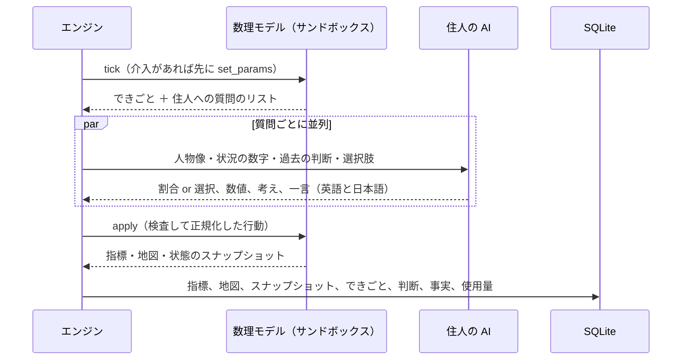

# Hakoniwa 設計メモ

数式で動く小さな世界に、AI の住人が暮らす「箱庭」を作って観測する道具です。

## 1. 考え方

| 担当 | やること |
|---|---|
| 数理モデル（Python の小さなコード） | 世界の数字をすべて持つ。人数、お金、行列、輸送力、所要時間など。1 ティックずつ式で進める |
| AI の住人 | 行動だけを決める。モデルが聞いてきたときに、選択肢の割合（集団）か 1 つの選択（個人）と、数個の数値を返す。一言しゃべる |
| 観測者（人間） | 眺める。止める。パラメータを変える。事件を起こす。分岐させて比べる |

MiroFish との違いは次の 3 点です。

- 世界の状態が「発言の積み重ね」ではなく、数式で管理された数字であること。
- AI を呼ぶのは判断が要る場面だけなので、安くて速いこと。
- 同じ乱数の種で分岐できるので、「介入した世界」と「しなかった世界」を並べて比べられること。

## 2. 全体の流れ

1 ティックの中身は次のとおりです。

## 3. 層の分け方（クリーンアーキテクチャ）

依存は内側にだけ向きます。

| 層 | 場所 | 中身 |
|---|---|---|
| domain | `hakoniwa/domain/` | 世界の仕様とコードの検査、行動の正規化、料金の計算。純粋な関数だけ |
| application | `hakoniwa/application/` | 実行エンジン、世界の設計、費用の見積もり、レポート・インタビュー。外部とつなぐ口は `ports.py` |
| infrastructure | `hakoniwa/infrastructure/` | SQLite、サンドボックス（Docker / サイドカー / プロセス）、OpenAI 互換のクライアント、環境変数 |
| interface | `hakoniwa/interface/` | HTTP の API、CLI、ビューア |

ドメイン層は薄くしてあります。数理モデルには DDD を使っていません。状態は普通の辞書、更新は関数です。状態をそのまま JSON で保存できるので、分岐と再現が確実になります。

## 4. 世界の決まりごと

世界は `spec.json` と `model.py` の 2 つです。`model.py` は標準ライブラリだけを使い、次の関数を持ちます。

| 関数 | 役割 |
|---|---|
| `init(params, rng)` | 最初の状態を作る |
| `step(state, params, rng, t)` | 1 ティック進める（数式） |
| `decisions(state, params, t)` | 今、誰に何を聞くかを返す |
| `apply(state, params, rng, t, action)` | 住人の答えを状態に入れる |
| `metrics(...)` / `view(...)` | 指標と、ビューアの地図 |
| `invariants(...)` | 保存則などの検査 |
| `on_params(...)` | 途中でパラメータが変わったときの処理 |

大事な決まりは 3 つです。

- **質問には必ず `default`（AI なしのときの動き）を付ける。** モデルは `default` だけでまともに動かないといけません。これが「AI なしの基準」になり、費用の見積もりにも使います。
- **住人に聞くのは控えめに。** 最初と、見えている状況が大きく変わったときと、ゆっくりした周期だけです。その間は前の答えが続きます。
- **大人数は集団で表す。** 1 人 1 オブジェクトにはしません。物語のために、名前のある個人を数人足せます。

分岐しても外からの乱数（案件の到着、天気など）が同じになるように、`random.Random(seed * 100003 + t)` を使います。

## 5. サンドボックス

AI が書いたコードは、次の条件でしか動きません。

| 方式 | 使う場面 | 隔離 |
|---|---|---|
| `docker` | ホストでエンジンを動かすとき | 世界ごとに使い捨てのコンテナ。ネットワークなし、読み取り専用、権限なし、メモリ 256MB、CPU 1 |
| `remote` | `docker compose` のとき | 外に出られない内部ネットワーク上のサイドカー。世界ごとに新しいプロセス。秘密情報なし |
| `process` | テストと、同梱のサンプル | 隔離なし。AI が書いた世界は拒否する |

多層の守りにしています。保存前に AST で検査（許可した import だけ、`open` や `eval` は禁止）、実行時は組み込み関数を制限、1 回の操作に時間制限、そのうえでコンテナの隔離です。

## 6. データ（SQLite 1 ファイル）

| 表 | 中身 |
|---|---|
| `worlds` | 仕様、コード、調査メモ |
| `runs` | 実行。分岐元と分岐したティックを持つ |
| `ticks` | ティックごとの指標と地図 |
| `snapshots` | ティックごとの状態と乱数の状態。どのティックからでも分岐・再開できる |
| `events` | できごと、住人の発言、介入 |
| `decisions` | 質問と答え、考え、トークン数、費用 |
| `facts` | 時間つきの事実（「誰の・何が・何である」が、いつからいつまで真か） |
| `llm_calls` | 使用量と費用 |
| `chats` / `reports` | インタビューとレポート |

`facts` は、外部の時間つき知識グラフのサービスの代わりです。パラメータの変更、住人の方針、モデルが宣言した事実を、有効期間つきで持ちます。「このティックの時点で何が真だったか」を引けます。

## 7. 費用の見積もり

1. AI なしでモデルを 1 回空回しします（無料）。住人への質問の回数が正確に数えられます。
2. 質問ごとに本物のプロンプトを組み立てて、入力トークンを数えます。
3. 出力トークンは、そのモデルの実績が 20 回以上あれば実測の平均を使い、なければ仮定の値（380）を使います。
4. `prices.json` の単価を掛けます。低め（× 0.7）と高め（× 1.6）の幅も出します。

本物の住人は展開を変えるので、質問の回数は実際には少しずれます。

## 8. 確認できたこと（2026-11-25）

| 確認したこと | 結果 |
|---|---|
| 自動テスト | 14 本すべて通過 |
| 中央線（Luna、36 ティック） | 127 回、$0.029、65 秒。見積もりは $0.039（幅 $0.027〜0.062） |
| 伊豆大島（Luna、104 週 × 2 本、分岐と介入、Sol のレポート） | 合計 約 $0.03 |
| AI による世界の設計（商店街とスーパー、Sol medium、ウェブ調査あり） | 1 回目で合格。463 行のモデル、$0.32、約 6 分 |
| 設計された世界を Docker 内で実行（サイドカー方式） | 254 回、$0.044 |
| サンドボックスの隔離 | 通信できない、書き込めない、API キーを持たない |
| 住人のモデルを変えた比較（中央線） | Luna と Terra の差は、Luna 同士のぶれと同程度。Sol は傾向が違った（1 回ずつなので要追加確認） |

## 9. 分かっている限界

- サンプルの数字は、出典が書いてあるもの以外は仮定です。予測ではありません。
- AI の住人を入れると、AI なしの基準から全体がずれます（例：伊豆大島では来島者が少なめに出ました）。現実に合わせたいときは、AI ありの状態でパラメータを合わせ直す必要があります。
- 同じ設定でも、AI の答えは毎回少し違います。結論を出すときは、何回か走らせて幅を見てください。
- プリセールスの世界は、同じ乱数の種でも編成ごとの差が種によって入れ替わります。複数の種で比べてください。
- インタビューは観測だけです。住人に話しかけても、世界は変わりません。
- ビューアにログインはありません。外に公開しないでください。
- OpenAI 以外の提供元では、ウェブ調査（Responses API の `web_search`）は使えない見込みです。その場合は `HAKONIWA_RESEARCH=none` にします。
