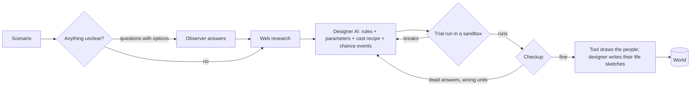
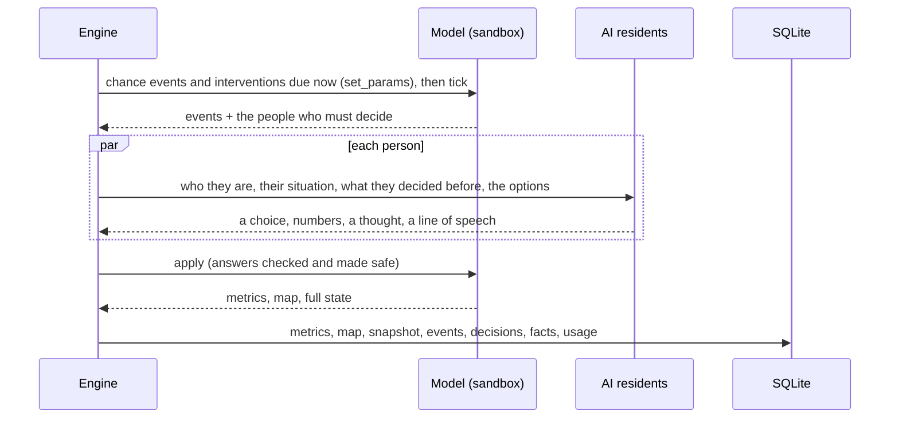

# Hakoniwa design notes

[日本語](./DESIGN.ja.md)

Hakoniwa builds small worlds that run on rules, with AI residents, and lets you watch them. These notes describe how it is put together as of v0.2.4. Research and reasoning behind the residents are in [DESIGN-life.ja.md](./DESIGN-life.ja.md) (Japanese); what the tool reproduced of real events is in [reports/](./reports/).

## 1. The idea

| Who | Does what |
|---|---|
| The world (an automaton) | Holds every number: stock, queues, money, who knows what. A small Python model advances it one tick at a time by fixed rules |
| The cast | A few hundred individuals, each a small automaton of their own: a handful of values (what they hold, their plan) and a life sketch |
| AI residents | Decide for one person at the moments that matter: when news reaches them, when something fails, when things return to normal. The answer rewrites that person's values |
| The observer | Watches, pauses, changes parameters, steps in on one person, forks a run, and compares the branches |

Three things follow from this split.

- The state of the world is numbers under rules, not a pile of conversation. It can be saved at every tick, forked from any tick, and compared with recorded figures.
- AI is asked only where someone decides. The cost of a run is about (people) × (times each is asked), and hardly depends on how long the world runs.
- The same seed gives the same outside events, so a branch differs from its parent only by what was changed.

**Two modes, one engine.** Besides a society of a few hundred, a world can be about one person at a crossroads (a "life world"). The person comes from an interview and is given to the model as they are; the cast is the people around them; a `path` parameter fixes only what the person does at the start; `spec.focus` names the person, the paths and the outcomes to show (satisfaction, regret, how others regard them). The viewer then shows such a world as its futures: every path run several times with the same seeds, side by side, with a report across them and a talk with any future self. Nothing in the engine is special to it.

## 2. How a world is built

- The world gets its id and its page the moment building starts. Several can be built side by side.
- **Checkup** is a set of free rehearsals with no AI: every answer is tried on everyone in turn. It finds answers that change nothing, people who are never asked, figures that never move, and recorded figures in another unit. Defects go back to the designer before the life sketches are paid for.
- Real data pasted by the observer travels with the world. Columns named as inputs drive the rules; observed outcomes are only charted next to the simulated figures, and the rules never read them.
- A finished world can be taken further: the observer writes what they think of it, AI turns that into the scenario for a new world, and the new world remembers which one it grew out of.

## 3. One tick

What shapes a resident's answer:

- **Their own description and life sketch**, different for every person. Without it residents react half as much again.
- **The first option is always "carry on exactly as before".** The engine treats it as the person's habit.
- **The formula's answer** (`default`) is shown as the likely answer; the resident departs from it when their character or circumstances give a reason. The instructions also say that most people change nothing on most days.
- **What they were told and what happened to them**: words from the observer, and personal chance events, stay in their situation for later questions.
- Two optional corrections, off by default: a decision model first judges whether the person stops to think at all; and only a share of residents act on a change of mind.

**Chance events.** A world carries a deck of things that may simply happen, to the world (a parameter changes for a while) or in some people's own lives (a line they keep in mind). Which happen and when is drawn from the run's seed before the run starts, so every fork of a run meets the same events and another seed gives another future.

## 4. Layers (clean architecture)

Dependencies point inward only.

| Layer | Where | What |
|---|---|---|
| domain | `hakoniwa/domain/` | Checks of a world's spec and code, decisions made safe, the cast drawn from a recipe, chance events, prices. Pure functions |
| application | `hakoniwa/application/` | Run engine, world designer, checkup, cost estimate, reports and questions. Everything outside is behind `ports.py`: the store is a `Store` protocol of about forty methods, and nothing here or in `domain` knows it is SQLite. Another database is another adapter in `infrastructure` |
| infrastructure | `hakoniwa/infrastructure/` | SQLite, sandboxes (Docker, sidecar, process), the OpenAI-compatible client, settings |
| interface | `hakoniwa/interface/` | HTTP API, CLI, the viewer (plain JavaScript, no build step) |

The domain layer is thin, and the world models use no domain-driven design: state is a plain dictionary and updates are functions. That is what makes saving, forking and replaying exact.

## 5. The world contract

A world is `spec.json` (parameters, the kinds of resident, metrics, charts, what-if events, chance events) and `model.py` (standard library only). It may carry data: the cast, and recorded figures.

| Function | Role |
|---|---|
| `init(params, rng)` | The first state. People live in one list of dictionaries with readable keys |
| `step(state, params, rng, t)` | One tick of rules |
| `decisions(state, params, t)` | Who must decide now, each with options and a `default` |
| `apply(state, params, rng, t, action)` | Put an answer into that person's state |
| `metrics(...)` / `view(...)` | Figures, and the map of places |
| `invariants(...)` | Conservation checks |
| `on_params(...)` | A parameter changed mid-run |

Rules that matter: every question has a `default`, so a world runs with no AI at all (the free rehearsal behind the cost estimate, the checkup and the "fixed rules only" baseline); physical limits live in the rules (a tank is finite, a shop cannot sell what it lacks); what people tried to get is recorded apart from what they got.

## 6. Sandbox

Code written by AI runs only under these conditions.

| Backend | Used when | Isolation |
|---|---|---|
| `docker` | The engine runs on the host | A throwaway container per world: no network, read-only, no capabilities, memory and CPU limits |
| `remote` | `docker compose` | A sidecar on an internal network with no route out; a fresh process per world; no secrets |
| `process` | Tests and the bundled samples | None. Refuses worlds written by AI (and worlds brought in through Data) |

Layers of defence: code is checked before it is saved (allowed imports only, no `open` or `eval`), built-ins are restricted at run time, every operation has a time limit, and the container isolates the rest.

## 7. Data

One SQLite file.

| Table | Holds |
|---|---|
| `worlds` | Spec, code, research notes. A world being built or failed is a row too |
| `runs` | A run, the run it was forked from and at which tick, its settings |
| `ticks` | Metrics and the map at every tick |
| `snapshots` | The full state and random state at every tick: any tick can be forked, replayed, or shown as the board of people |
| `events` | World news, speech, interventions, chance events |
| `decisions` | Every question and answer, the thought, tokens and cost |
| `facts` | Facts with a period of validity (who, what, from when to when) |
| `llm_calls`, `chats`, `reports` | Usage, interviews and questions, written reports (Markdown per language; tables built by the program, short written pieces by AI) |

- **Data menu.** Chosen worlds and runs are saved as one SQLite file with the same tables (gzipped by default) and can be brought into another database. Nothing is replaced on the way in: runs get new ids, a world is matched by its slug or added under a free name, and a world that comes in is treated as written by AI, so its code runs only in an isolated sandbox.
- **Backup folder** (`HAKONIWA_BACKUP_DIR`). For machines that do not keep their files: a whole compressed copy is written to the folder when something has just been completed (a run comes to rest, a world is built, a file is brought in), every few minutes when something changed, and once more on shutdown; a machine that finds no database starts from the copy. The live database never sits in that folder. See [CLOUD_RUN.md](./CLOUD_RUN.md).

## 8. Cost estimate

1. The model runs once with no AI (free). That counts the questions exactly.
2. The real prompt is built for each question to measure the input.
3. Output per answer is the observed average for that model when there are 20 or more calls, otherwise an assumed 380 tokens.
4. Prices come from `prices.json`. A low (× 0.7) and a high (× 1.6) figure are shown.

Real residents change the course of a run, so the count shifts a little.

## 9. Colour

The brand is ten colours, from deep purple to mint. The pixel-art town and icon use only these; a block's side faces take the next one or two darker steps, so shading never leaves the palette.

| # | Hex | Used for |
|---|---|---|
| 0 | `#7400b8` | Darkest shadow in the art |
| 1 | `#6930c3` | Accent text (light mode), sequential step 6 |
| 2 | `#5e60ce` | **Accent**: buttons, links, the highlighted word of a headline, sequential step 5 |
| 3 | `#5390d9` | Sequential step 4 |
| 4 | `#4ea8de` | Sequential step 3 |
| 5 | `#48bfe3` | Water in the art |
| 6 | `#56cfe1` | Sequential step 2 |
| 7 | `#64dfdf` | Leaves in the art |
| 8 | `#72efdd` | Sequential step 1, accent text (dark mode) |
| 9 | `#80ffdb` | Highlights, lit windows |

The roles colour plays in the viewer:

| Role | Colours | Rule |
|---|---|---|
| Magnitude (how much) | `--seq-1` … `--seq-6`: six of the brand colours, light to dark (reversed in dark mode) | The map's circles, a numeric state on the board |
| Identity (which one) | `--series-1` … `--series-8`: `#257de0` `#f47230` `#00b894` `#f2a600` `#ee7fac` `#008a17` `#6a4ce2` `#ec4647` | Chart lines, runs being compared, states and answers on the board. Given in fixed order; a thing keeps its colour. These are not brand colours: neighbours in the brand ramp are too alike to tell lines apart, also for colour-blind readers |
| "As before" / not asked | `--axis` grey, filled / white with a grey outline | The habit answer never competes with the answers that changed |
| Status | `--good #0aac23`, `--warning #fbb315`, `--serious #f18a59`, `--critical #dc3c3d` | Only for state (▲ low, ! critical), always with a glyph, never as a series colour |
| Text and surfaces | `--text-primary #191919`, `--text-secondary #666666`, `--page #f9f9f9`, `--surface-1 #ffffff`, `--grid #e7e7e7`, `--axis #c2c2c2` | Numbers, labels and legends are always text colour; the coloured mark beside them carries the identity |

Dark mode has its own steps of the same roles (`style.css`), not an automatic inversion.

## 10. What is known

- Four real events were replayed and compared with recorded figures ([reports/](./reports/)). Timing and shape came out; the size of people's reaction is the weak point, and how residents are asked moves it as much as who they are.
- One run is one sample. Two runs that differ only in the seed can be a week apart on when something begins.
- Worlds differ from build to build. The same scenario built twice gave different fixed-rule behaviour.
- The board's "last answer" colouring shows what a person said, not the state the rules hold for them; the state view and the state diagram show the latter.
- Interviews do not change what a resident does. Stepping in on a person does, as a fork.
- The viewer has no login. Keep it on 127.0.0.1, or put an identity-aware proxy in front of it.
- With providers other than OpenAI, web research (the Responses API `web_search` tool) and the decisions API are likely unavailable; set `HAKONIWA_RESEARCH=none`.
